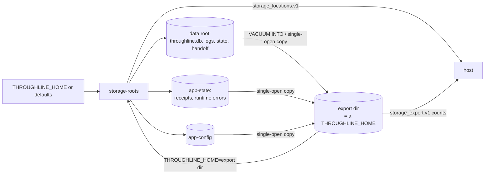

# ADR 0073: Storage location and export are a public contract

Date: 2026-11-14

## Context

A host product (BellTeam) handled Throughline's storage by its own knowledge of the layout:

1. Its live-volume archive hard-coded `state/throughline` and the fact that Throughline replaces each
   JSON store by a dot-prefixed `.tmp` file and a rename.
2. Its container bind-mounted a host directory onto `~/.throughline` to choose where the database lives,
   and its package probe checked that `.throughline` and `state` were not created.

Neither the layout nor the write manner was a promise. Any change in Throughline would silently break the
host's backup and placement. The Owner ruled (2026-11-14) that products connect only through contracted
interfaces drawn in the function and data-flow diagrams.

## Decision

Throughline promises three interfaces. Everything else under its roots stays private.

1. **Location setting: `THROUGHLINE_HOME`.** When set, it is the one root for everything Throughline
   persists, on every OS and harness. A relative value resolves against the user's home directory.
   When unset, the existing defaults stay unchanged (no migration for existing installs).

   | role | `THROUGHLINE_HOME` set | unset (POSIX) | unset (Windows) |
   |---|---|---|---|
   | data (DB, logs, session state, handoff state) | `$THROUGHLINE_HOME` | `~/.throughline` | `%USERPROFILE%\.throughline` |
   | app state (completed-turn receipts, runtime errors) | `$THROUGHLINE_HOME/app-state` | `$XDG_STATE_HOME/throughline` | `%LOCALAPPDATA%\throughline` |
   | app config (runtime error reporting settings) | `$THROUGHLINE_HOME/app-config` | `$XDG_CONFIG_HOME/throughline` | `%LOCALAPPDATA%\throughline` |

   Every process that runs Throughline (hooks, CLI, server callers) must see the same value. A process
   that does not see it uses the defaults and writes a separate store.

2. **Location query: `throughline storage locate --json`** prints `throughline.storage_locations.v1`:

   ```json
   {
     "schema": "throughline.storage_locations.v1",
     "source": "THROUGHLINE_HOME",
     "roots": { "data": "/abs", "appState": "/abs/app-state", "appConfig": "/abs/app-config" },
     "database": "/abs/throughline.db"
   }
   ```

   `source` is `THROUGHLINE_HOME` or `default`. It reads nothing and creates nothing.

3. **Export: `throughline storage export --to <dir> --json`** writes a consistent copy of all roots into
   `<dir>`, laid out as a `THROUGHLINE_HOME` (data files at the top, `app-state/`, `app-config/`).
   Pointing `THROUGHLINE_HOME` at the export, or copying it into an empty `THROUGHLINE_HOME` while no
   Throughline process runs, restores it. It also moves a default-layout install to a `THROUGHLINE_HOME`.
   - `<dir>` must not exist or must be an empty directory, and must not lie inside a source root
     (protects existing state from being overwritten). Otherwise `storage_export_target_not_empty` or
     `storage_export_target_inside_source`, exit 1, nothing written.
   - Each SQLite store is copied with `VACUUM INTO` from a read-only connection, so the copy is one
     committed state even while writers run. WAL/SHM/journal sidecars are not copied.
   - Every other file is read through one open. JSON stores are replaced by rename, so one open always
     sees one complete document. Logs are appended, so a copy may end before the newest line.
   - Not copied, because Throughline recreates them: lock databases (`*.lock.sqlite`,
     `.log-retention.sqlite`, `.lifecycle.sqlite`), in-flight `.tmp` files, `haiku-workdir/`,
     `terminal-runtimes/`. A file that disappears during the export is skipped.
   - The copy is not one instant across files: each file is consistent alone.
   - On success it prints `throughline.storage_export.v1` with `status: "complete"`, the resolved
     source roots, `to`, and counts (`files`, `sqlite`, `bytes`). On failure it prints
     `{ "schema": "throughline.storage_export.v1", "status": "failed", "code": "...", "message": "..." }`,
     exits 1, and leaves the partial `<dir>` for the caller to delete.

Hosts back up Throughline with `storage export`, choose placement with `THROUGHLINE_HOME`, and ask
`storage locate` where things are. They never read or write inside the roots by their own knowledge.

## Function diagram

```mermaid
flowchart LR
  Host[Host product / user] -- env THROUGHLINE_HOME --> Roots
  Host -- storage locate --json --> Locate[cli/storage.mjs locate]
  Host -- storage export --to --json --> Export[cli/storage.mjs export]
  Roots[src/storage-roots.mjs\ndataRoot / appStateRoot / appConfigRoot]
  Locate --> Roots
  Export --> Roots
  Hooks[hooks and CLI: db, state-file, logs,\nauto-handoff, receipts, runtime errors] --> Roots
```

## Data-flow diagram



## Consequences

- The host backup no longer needs Throughline's file names or write manner.
- The host no longer mounts onto `~/.throughline`; it sets `THROUGHLINE_HOME` to a directory it owns.
- Every hard-coded `~/.throughline` and XDG/LOCALAPPDATA join in the product goes through
  `src/storage-roots.mjs`; a new storage path must too.
