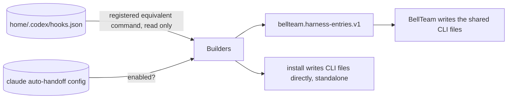

# ADR 0074: harness-entries publishes Throughline's native hook entries (BellTeam E1)

Date: 2026-11-14

## Context

`throughline install` writes into files other products also write: `~/.claude/settings.json`,
`~/.codex/hooks.json`, the `[features]` table of `~/.codex/config.toml` and `~/.cursor/hooks.json`, plus
its own `~/.grok/hooks/throughline.json`. None of these writes is locked, and the Codex writes prepend at
index 0, which shifts the position-keyed trust of other products' Codex hooks.

BellTeam runs `install` on every configure. The Owner's boundary rule (2026-11-14) asks for one writer per
CLI file. BellTeam becomes that writer for its seat homes and reads each product's entries through E1 of its
contract (`docs/architecture/modules/runtime/cli-registration.md`, "One writer per CLI file", E1 v1.1,
BellTeam PR #1396 head 35c8bc23).

## Decision

`throughline harness-entries --json [--home <absolute-dir>]` prints E1, schema
`bellteam.harness-entries.v1`. It reads only `<home>/.codex/hooks.json` (default: the user's home) and the
Claude auto-handoff setting, and writes nothing. Every entry comes from the same builders `install` uses
(`src/cli/install.mjs`), so the two cannot drift.

```json
{
  "schema": "bellteam.harness-entries.v1",
  "product": "throughline",
  "version": "0.20.0",
  "mcpServers": {},
  "hooks": {
    "claude": { "SessionStart": [ { "hooks": [ { "type": "command", "command": "throughline session-start" } ] } ], "...": [] },
    "codex":  { "PreCompact": [ { "matcher": "auto", "hooks": [ { "type": "command", "command": "<node> <pkg>/bin/throughline.mjs codex-hook pre-compact", "timeout": 30, "...": "" } ] } ], "...": [] },
    "cursor": { "sessionStart": [ { "command": "<node> <pkg>/bin/throughline.mjs session-start", "timeout": 10 } ], "...": [] },
    "grok":   { "hooks": { "SessionStart": [ "..." ], "UserPromptSubmit": [ "..." ], "Stop": [ "..." ] } }
  },
  "permissions": {},
  "settings": { "codex": { "features.hooks": true } },
  "owns": { "commandIncludes": [ "throughline.mjs", "throughline session-start", "throughline codex-hook stop", "..." ] }
}
```

- Native and verbatim: Claude and Codex give the group exactly as `install` puts it in the file; Cursor
  gives the item; Grok gives the whole content of `~/.grok/hooks/throughline.json`.
- Codex commands are absolute node + CLI script paths. When `<home>/.codex/hooks.json` already holds an
  equivalent command (same node and script, other spelling), the registered string is returned so Codex
  hook trust is kept (ADR 0052).
- Claude auto-handoff hooks (ADR 0033: `PreCompact`, `PreToolUse`, `Stop` wait hook) are included only
  while `throughline auto-handoff` is enabled for Claude, as `install` does. Toggling auto-handoff still
  writes `~/.claude/settings.json` itself; the writer runs `harness-entries` again after toggling.
- `owns.commandIncludes` names every command Throughline writes or wrote: the CLI script name
  `throughline.mjs` (Codex, Cursor and Grok forms, any node, any quoting) and the PATH-form commands,
  including retired ones (`throughline inject-context`, `node src/turn-processor.mjs`, ...).
- `settings.codex['features.hooks']`: BellTeam sets it only when absent. `install` additionally removes the
  legacy `codex_hooks` key; E1 has no remove form, so that removal stays with `install` on standalone hosts.
- Not in E1, because they are Throughline's own files rather than shared ones: `~/.claude/commands/tl.md`,
  `~/.claude/commands/sc-detail.md`, `~/.codex/skills/throughline/`, and the VS Code monitor task in the
  current project's `.vscode/tasks.json`.

Switchover follows BellTeam's contract: E1 alone changes nothing; BellTeam applies it and checks the seat
files are byte-equal; after BellTeam's one "applied" message Throughline stops writing the shared files for
BellTeam seat homes. `install` stays the writer on standalone machines.

## Function diagram

```mermaid
flowchart LR
  Host[BellTeam CLI registration, the one writer] -- harness-entries --json --home --> HE[cli/harness-entries.mjs]
  User[Standalone user] -- install --> Install[cli/install.mjs run]
  HE --> Builders[install.mjs builders:\nSC_HOOKS, CLAUDE_AUTO_HANDOFF_HOOKS,\ncreateCodexHooks, createCursorHookEntries,\ncreateGrokHooksFile]
  Install --> Builders
```

## Data-flow diagram



## Consequences

- A new hook must be added to the shared builders; `harness-entries` then lists it.
- `src/cli/harness-entries.test.mjs` runs `install` in a sandbox home and asserts that every E1 group, item
  and the Grok file are exactly what `install` wrote, and that `owns.commandIncludes` identifies every item
  `install` wrote.
