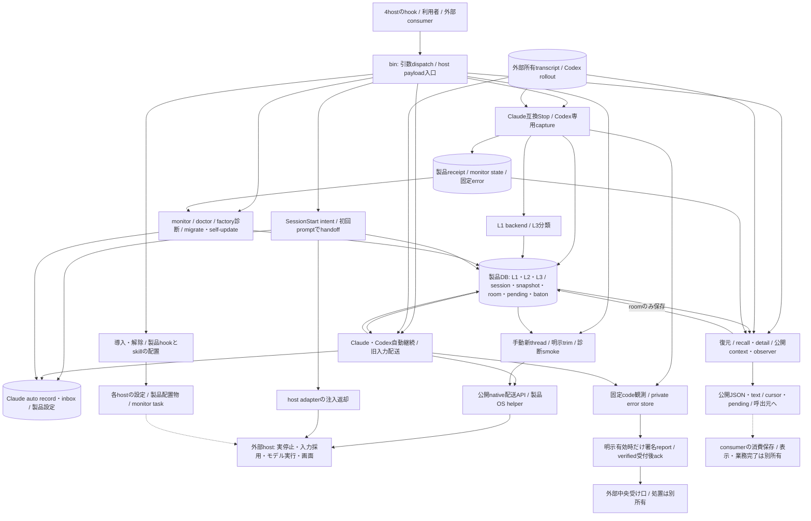

# Throughline 機能図とsource対応

状態: S1のhook命令/診断所有整理、S2説明同期、S3の全体から実関数/保持根拠への追補を含む最終整合候補。base `39ff812d46c0e84e8fc1418096c509551cf3928b`、実装固定59150e6、説明/検証固定7e66b04を基にする。S4初回CIの失敗後、確定したfixture不備を修正し、候補2cbe108の3OS全件とgateが成功した。初回exact原因の未確認を含む結果は末尾S4へ記した。S5の適用済みAstra最終整合を実施し、結果は末尾へ固定した。3OS全件/gate検証と、固定aaec11fの指導担当による全体成果受入は完了。通常保守へ引き継いだ。

- [未読台帳](unread-ledger.md): baseのtracked全417file。source126/test99/documentation141/config-support51を機械分類した。fixture4件と機械分類config-support内の現役script/設定14件は本文確認。残る意味分類と適用性は台帳へ分ける。
- [bytes/SHAと宣言候補](file-inventory.json): 宣言行の文字列索引は部分的な手掛かりで、実関数や全callerの網羅を保証しない。全fileのsemanticMappingCompleteはfalse。
- [今回読んだ入口と記録・引継ぎの現行図](current-entrypoints.md): CLI/SessionStart/DB、初回handoff、Stopの保存/receipt/L1/L3、Codex専用capture/hookの3追加詳細図と実file/関数対応。未読callee/caller/testを明記する。新4図は実描画/目視済み。最終照合の範囲と限界は末尾のS5を参照。
- [自動継続・旧会話入力・OS起動](current-continuation.md): Claudeのrecord/accepted/inboxとCodexの停止準備/不変snapshot/mutation stage/公開配送APIを、成功/確定失敗/unknown/cleanupへ結ぶ。Grok手動継続とOS共通部品も対応付ける。新3図は実描画/目視済み、全consumer閉包は未完。
- [文脈復元・observer・外部文脈](current-projections.md): 予算付きpush/pull、固定page/cursorと本文freshness、wait取消、auditor/caveat/roomをsourceへ結ぶ。observer現行図だけは既描画原稿/SVGを再利用し、復元/room新2図も実描画/目視済み、全consumer閉包は未完。
- [手動継続・trim・app-server診断](current-manual-continuation.md): 新threadへの記憶注入とモデル開始、同threadのrollback/injectとdurable診断、通信中断/cleanupを区別する。自動継続の永続状態と異なる責任なので別詳細とし、既存図の内部を複製しない。実描画/目視済み、全consumer閉包未了。
- [導入・監視・診断・更新・報告](current-lifecycle.md): 製品設定/信用と外部適用、複数fileの部分確定、readinessと実動作、送信受付/ack/解決を4現行図と実関数へ結ぶ。既存詳細と所有が異なる製品寿命/運用入口を一か所に置く。実描画/目視済み、全consumer閉包未了。
- 既存設計の索引は[docs/00_overview.md](../00_overview.md)、記録/復元の既存図は[README](../../README.md#three-layer-memory-model)、Codex継続は[docs/05](../05_codex_first_roadmap.md)。有効な図を作り直さず、対応を確認して再利用する。

## 全体で埋める機能

導入/host登録、4host記録、DB/schema/競合、記憶/要約/再注入、Claude継続、Codex継続/trim、Grok/Cursor継続、usage/monitor、observer、外部文脈projection、診断/更新/エラー報告を調べる。これは調査順序であり、責務分割の確定案ではない。
各機能は実file/関数・状態/所有・caller・test/fixture/config/export・正常/失敗/停止/取消/不明/cleanupまで結ぶ。部分図の完成を全体完成へ補完しない。

## 現行の全体接続

現行sourceを辿る概略で、新しいmodule分割案ではない。実描画/目視は済み、Astra最終照合の結果と未確認の接続は末尾のS5に示す。線は複数fileを一括commitする意味ではなく、破線は外部適用/consumerの証明範囲を分ける。Codex自動継続の台帳はDB、Claude record/inboxはprivate fileという違いを詳細へ残す。receipt・monitor state・固定errorは別の保存先で、図の一ノードへの併記を同じstateの所有/確定境界とは扱わない。
記録/初回は[current-entrypoints](current-entrypoints.md)、自動継続/OSは[current-continuation](current-continuation.md)、投影は[current-projections](current-projections.md)、手動nativeは[current-manual-continuation](current-manual-continuation.md)、導入/運用と個別storeは[current-lifecycle](current-lifecycle.md)を詳細正本とする。実関数と失敗/取消/unknown/cleanupは各表を辿り、欠けるものは未読台帳と次の意味調査に残す。

## 保持する外部契約

CLI名/引数/JSON schema/exit/stdout/stderr、ClaudeとCodex/Grok/Cursorのhost別hook形、記憶/receipt/cursor/baton/後継と設定信用、保存/移行とreport/ackの意味を保つ。既読だけで保持済みとはせず、全callerと関連試験へ結ぶ。
observer新batch APIはこの候補の構造整理に含めない。実DB/稼働会話/他製品/OSを変更せず、公開・配布・本番反映は既条件に従う。

## source調査・設計時点の記録

以下はS1実装前の調査・設計時点の記録である。現在の実装/検証は末尾のS3/S5と各詳細末尾を正本とする。

適用済みAstra xhighで以下の責務設計を行った。次はSol Highの適用後、採用した変更のcaller/test/fixture/config/exportを閉じて段階実装する。未調査213fileの全読了は開始条件にしない。全体の説明不足は末尾の残確認を埋め、実装/関連検証後にAstraの最終整合を行う。

機械分類source126file（fixture4を含む）の本文確認は済んだ。これは全機能の意味調査・全caller/test/fixture/config/exportの照合完了ではない。次は未読の関連試験・設定/配布入口・現行正本と外部consumerを調べ、図から実関数/状態/返却までの不足を埋める。

host adapter/identity・記録側helperは[入口詳細](current-entrypoints.md#host-adapterと記録側helperの対応追補)、本文digest/L3参照は[投影詳細](current-projections.md)、path比較とClaude保持試験は[継続詳細](current-continuation.md#自動継続の保持根拠と未検証境界)、usage/推定/要約復帰は[運用詳細](current-lifecycle.md#既存の観測表示helperの所有)へ追補した。機械source126pathは5詳細内の直接参照へ接続したが、pathの出現検査は全関数・動的caller・外部consumerの意味確認を保証しない。全semanticMapping/consumer閉包は未完。

最初のsource調査追補時点は本文58file（機械役割source47/test9/doc1/config1）、同blob参照1、未読358。以降の現在値は未読台帳を正本とする。source分類のうち現在4件は本文からfixtureと確認した。全fileの依存/consumer閉包は未了。各source調査ではbase417fileのSHA不変を確認した。今回の設計ではAGENTSに図/設計入口と未完状態を追補し、他416fileとruntime/設定は不変。関連testは本文読取だけで未実行。

## 描画と目視の固定対応

新17図は既導入Mermaid CLI 12.0.0でSVG/PNGへ描画し、PNGを個別表示してラベル・分岐・矢印を確認した。既observer1図は固定原稿/SVGを再利用し再描画していない。全体図は接続の交差が多いため機能詳細への索引として使い、単独で意味整合を証明しない。原稿は本Markdownのblockを正本とし、編集用の別原稿を二重管理しない。[描画manifest](render-manifest.json)にblockのSHA、SVG/PNGのSHA/bytes、確認状態を残す。

| 原稿 | block順のSVG | 状態 |
| --- | --- | --- |
| [README](README.md) | [1](diagrams/readme-01.svg) | 描画/目視済み |
| [current-continuation](current-continuation.md) | [1](diagrams/current-continuation-01.svg) / [2](diagrams/current-continuation-02.svg) / [3](diagrams/current-continuation-03.svg) | 描画/目視済み |
| [current-entrypoints](current-entrypoints.md) | [1](diagrams/current-entrypoints-01.svg) / [2](diagrams/current-entrypoints-02.svg) / [3](diagrams/current-entrypoints-03.svg) / [4](diagrams/current-entrypoints-04.svg) | 描画/目視済み |
| [current-lifecycle](current-lifecycle.md) | [1](diagrams/current-lifecycle-01.svg) / [2](diagrams/current-lifecycle-02.svg) / [3](diagrams/current-lifecycle-03.svg) / [4](diagrams/current-lifecycle-04.svg) / [5](diagrams/current-hook-ownership-01.svg) | S1所有詳細を含め描画/目視済み |
| [current-manual-continuation](current-manual-continuation.md) | [1](diagrams/current-manual-continuation-01.svg) / [2](diagrams/current-manual-continuation-02.svg) / [3](diagrams/current-manual-continuation-03.svg) | 描画/目視済み |
| [current-projections](current-projections.md) | [1](diagrams/current-projections-01.svg) / [2](diagrams/observer-current.svg) / [3](diagrams/current-projections-03.svg) | observer既確認再利用を含む |

初稿の復元図だけ、detailとrecallの結線を実関数に合わせて訂正し、その1図を再描画/目視した。変更理由は詳細本文とmanifestへ残す。他のblockの意味変更は無し。図の可読性確認は全caller/test/fixture/config/exportの閉包・実host受入・責務整理の採否・Astra最終整合ではない。

## 責務設計と採否（2026-11-03、Astra xhigh）

この節は実装前の設計である。get_selfでAstra xhigh/fast OFFの適用受理を確認してから、固定候補の全体/5詳細、既読source・関数・保持試験の対応を評価した。本文確認203file/同blob1/未読213と全semanticMapping未完は変えない。機械source126pathの出現、描画済み、設計の採用は、全関数/動的caller/実consumerの照合や最終受入の証拠ではない。

5詳細の「採否未定」「次工程で調べる」はsource読取時点の記録である。現在の採否と順序はこの節を正本とし、実装済みの接続は各現行図へ戻す。未読/未検証の状態は設計の採用だけでは進めない。

### 対象全体の所有と構造判断

| 機能・図の正本 | 維持する責任/接続 | 今回の構造判断と理由 |
| --- | --- | --- |
| CLI dispatch・hook入口 → [入口](current-entrypoints.md) | binは引数/公開名/入口例外、各runはstdin/host返却、固定errorとprivate logは別 | 変更不要。入口と実処理の既分離を使う。hookごとにexit2/deny/continue/skipが異なり、共通catch/汎用runへまとめない。hook統合試験の未読は残す |
| DB/schema・merge・pending/baton → [入口](current-entrypoints.md) | getDb/openReadOnlyDbが接続、各writerがtransaction/保持を所有 | 変更不要。migrationやmergeの一括確定とpending/batonの個別確定を「unit of work」へ包み直すと失敗時契約が変わる。schema/保存path/保持期限は変更しない |
| 4hostの記録・L2/L3・receipt・L1 → [入口](current-entrypoints.md) | host adapter/identity、transcript reader/backfill、Codex capture、receipt、既summarizerがそれぞれの規則を所有 | 変更不要。Claude append/Grok書換世代/Codex rollback後置換は別契約。汎用parserや共通completionを作らず、既body-digest/turn-start/L3 helperを使う。全parser fixture閉包は未完 |
| 初回handoff・prompt実験 → [入口](current-entrypoints.md) | executorがpending→選択→merge→accepted→backfill→context、promptはhost配送/forward/slashを調停 | 本体分割は見送る。既executor/adapterに作用が分かれ、runは順序の所有者として残す。spikeはmarker限定の既helper境界があり、移動だけでは順序・保持の曖昧さを解かない。削除/本線化/有効化をせず、実験の作用を索引に残す |
| Claude auto・forward → [継続](current-continuation.md) | private record/accepted/claim/inboxとOS terminalが別所有。workerは作用順を調停 | 変更不要。大きさだけでrecord/worker/後継照合を再分割するとlate write・受領優先・再送禁止の相関が隠れる。既config/forward/terminal分離を維持し、同じ状態へ触る処理は現在の所有者に残す |
| Codex auto → [継続](current-continuation.md) | storeのCAS/snapshot、memoryの描画/要約、host観測、公開配送、orchestrator | 変更不要。既store/memory/host/runtime分離を再利用する。sourceStopGate/実停止/mutation_stage/continuedと後続goal/queueは別確定。Claudeと共有state machineへまとめない |
| 文脈/pull/public projection → [投影](current-projections.md) | HandoffRecordは中間表現、各rendererが予算/表現、公開CLIがDB接続/JSON/exit | 変更不要。9500字push、短い手動引継ぎ、auto全文、observer完了投影を共通formatterへ統一しない。read-onlyへの一括変更もCLI接続作用を変えるため不採用 |
| observer・auditor・caveat・room → [投影](current-projections.md) | 完了根拠、本文freshness、consumer消費位置、room書込は別所有 | 変更不要。共有済みpair照合/digestを使い、room writerをread-only群へ入れない。batch/token/daemon/poolは別工程。確認だけでconsumer cursorを進めない |
| 手動new-thread・trim・診断smoke → [手動](current-manual-continuation.md) | app-serverがtransport/要求相関、明示操作がnative順序、CLIがopt-inと表示 | 変更不要。autoの永続台帳を手動経路へ足すことは機能/保持変更。close/timeoutをremote rollbackと解釈せず、既guardとunknown限界を記す。旧停止中の実験を再開しない |
| hook導入/解除・信用検査 → [運用](current-lifecycle.md#採用設計-hook命令とcodex診断の所有を分けるs1実装済み) | installは設定書込と配布、host hook命令は形/実体照合、診断は既設定の観測、doctorは表示、factoryは公開投影 | **構造変更を採用**。factory→doctor._internalと診断→installer本体への迂回を除き、命令の既処理とCodex検査を各専用moduleへ移す。旧exportは互換参照として保持。詳しい境界/代替案/図は運用詳細へ一度だけ置く |
| monitor・VSCode task → [運用](current-lifecycle.md) | state/live usage合成、表示cache/端末寿命、task配置は既別helper | 変更不要。現在の表示helperを別fileへ移すだけではsingle mainのcache/信号寿命が明瞭にならない。既terminal-size/usage/taskを再利用し、main/signalの未coverageを明記する |
| OS/起動・自己更新 → [継続](current-continuation.md)・[運用](current-lifecycle.md) | os配下のquote/PTY/ACL/runtime/package journal、self-updateの順序 | 変更不要。既共通所有者を使う。Windows昇格rollbackと後段install/migrateを同一transactionにしない。新OS/Host責任を増やさない |
| runtime error・送信・回復 → [運用](current-lifecycle.md) | store/context/observer、report/trigger、中央の受付/処置は別所有 | 変更不要。JSON置換とlock、ackとresolve、報告の再送とnative unknownの禁止を分けたままにする。既定OFF/署名/許可field/expectedCursorを保持 |
| config/temp/path helper → 各詳細 | host別configのschemaと既定、各writerのACL/lock/cleanup、project比較の意味を各所有者が持つ | 統合しない。似たtemp→renameでも権限・失敗・CAS・掃除・直書きが異なる。sameProjectPath/子孫/SQL lower、shell quoteの変更を「整理」として混ぜない。既共通helperで同契約を扱っている箇所は維持 |
| 配布文書・CI・旧保守script → [運用](current-lifecycle.md) | 現行説明はREADME/現行docs/配布skill、版履歴はADR/archive、選択試験/releaseは製品CI | **確定した説明差分の訂正を採用**。runtimeを古い説明へ戻さない。旧installer/one-offは現役公開入口でないことを明記し、利用履歴未確認の削除/移動はしない。既CIを作り直さない |

変更しない判断は、対象の全試験合格や全private関数の意味確認を表さない。現在の責任分離で目的を満たせる理由を示したもので、後段で図の説明が足りないと分かればその範囲を埋める。何も変えないために未調査を隠すことも、全fileを形式的に分割することもしない。

### 段階と検証の受け渡し

| 段階 | 実施内容・完了条件 | モデル/残確認 |
| --- | --- | --- |
| S1 共有hook命令/診断 | 運用詳細の採用案について全caller/再export/test/fixture/config/packを確認し、既処理を移動。doctor/factory/installの観測と返却が不変、旧import面が保持され、下位moduleからCLIへの依存が無いことを確認 | 次ターン以降Sol High。対象以外の大規模test読了を開始条件にしない。必要な仮home/DB/process fixtureだけを実行し、実Host設定/CLIは操作しない |
| S2 現行説明の同期 | tl/skillの注入量、docs02の確定順、docs04の診断作用、README両言語のdependency/backend/reportを実関数と既試験へ照合して訂正。AGENTS内の同じ旧説明も同期し、過去ADRは置換関係を残す | Sol。READMEのThinking/detailは未確定項目として先に関連test/表示枝を確認する。機能追加や表示枝修理を説明訂正へ紛れ込ませない。確認できない約束を達成済みと記さない |
| S3 全体対応の不足を閉じる | 全体/5詳細→実関数/状態/失敗返却→代表caller/保持根拠を再照合。特にCodex auto/hook/復元/外部consumer、import時作用/直接実行/取消とcleanupの未説明を埋める。対象外資料は理由を残す | Solの実source調査。必要な関数/試験を読み、宣言文字列だけで完了しない。既共有部品の再分割や全99test/未読213件の一律読了を関所にしない |
| S4 関連検証と図の同期 | 採用差分に対応するfocused testsと既product-ci-planの選択/拡張理由を保存、verify:docsとpackリンクを確認。現在図を実装に合わせ、意味の変わったblockだけ描画/PNG目視/hash/XMLを更新 | Sol。既CIが広い確認を選ぶ場合は既ルールとして扱う。既18図の無変更反復なし。試験skip/未実行/OS未確認を分ける |
| S5 最終整合/固定返却 | 完成候補全体の図・責任・接続・関数・保持・検証をAstraで照合。未確認/既知制限と本番未反映を含めレヴィアタンへ固定成果を返す | Astra xhighの正規変更/次ターン適用後。今回の設計確認を最終整合へ代用しない。公開/本番は既手順、batchはさらに別工程 |

S1/S2の変更前確認は既Owner手順であり、新しい人の承認関所ではない。設計で指名した責任を動かす必要が生じた時だけ採否を見直す。構造整理の実装は、その完成後に行うS5を先行条件にして止めない。

### 残る意味確認と保持の境界

- Codex auto本体/hook統合、resume/context、backfill/各parser等の大規模testは未読が残る。変更が届く試験は実装前に読む。変更不要領域も全体説明の根拠が足りない箇所をS3で補い、未読数やpath出現だけでsemanticMappingCompleteを立てない。
- BellTeamのhandoff-context/observer/roomの公開consumer、Spotter/Caveat、配送APIの外部内部は別所有。公開JSON/exit/入力制限/消費cursorの境界を既callerへ照合する。旧deep import/exportは候補内参照と既知consumerを検索し、到達できない利用は未確認とする。他席checkoutを変更しない。
- 取消APIの無い同期処理は「不適用」、強制終了/通信喪失は段階ごとの既確定とunknownを記す。accepted/captured/queued/continued/ready/updated/ackを一つのdoneへ変換しない。
- sc-detailのThinking表示、doctorのNode最低版表示、旧installer呼出、temp残存/一部writerのCAS無し、monitor signal寿命などは既知の未照合又は制限。今回の二つの構造境界の整理で自動解決したことにしない。

S1実装記録は[運用詳細末尾](current-lifecycle.md#s1実装と保持確認2026-11-03)へ。既処理の移動と旧参照保持を実装し、focused70件と登録/import選択5件が通過。第5図を実装の現行接続へ更新した。S2の説明同期と関連31件は[運用詳細のS2記録](current-lifecycle.md#s2説明同期と保持確認2026-11-03)へ。S3と既CI全体範囲、最終整合は継続する。

## 最終整合へ渡す候補の範囲（S3追補2）

S1/S2の後に、全体図の15機能群を5詳細の責任/接続/実関数/状態/失敗・停止・取消・unknown・cleanupへ戻し、公開helperの索引と保持根拠を追補した。記録/Codex capture・hook、autoのstore/起動/配送文、manualのprotocol補助、復元/recent/公開projection、運用config/ACL/表示は各詳細末尾を現在の対応とする。上段のsource調査時点の「次工程」「未実行」は履歴として読み、現在の結果と混ぜない。

- 追加の構造変更は採用していない。既source本文/固定Astra採否と照合して既責任へ結び、S1以外のstate machine統合、temp writer統合、共通parser、新API/daemon/取消機構は作らなかった。
- S1変更対象の旧/new import・再export・既caller・設定・fixture・packはS1保持記録へ。S2の変更先は配布command/skill/README/現行docs/AGENTSへ閉じ、履歴ADRは保存した。以後の差分は図の対応表/manifestだけでruntime/config/testを変更していない。
- named function exportの文字列索引488件（試験helperも含む）に詳細内の名前の欠落が無いことをassertした。初回検査でS1新moduleの具体名8件と試験helper4件の不足が分かり、実sourceと役割を確認して正本へ追補した。これは全AST/alias/class method/動的callerやprivate branchの意味確認完了を示す検査ではない。
- 本文確認213/同blob1/partial4/未読199。source126pathの本文確認は全体索引の土台とし、未読資料を一律必読にしない。source本文を調べた範囲と、残る全semantic/consumer未確認を台帳へ分ける。全fileのsemanticMappingCompleteは全関数/全consumer閉包を表すためfalseを保持する。S5の対象全体の責任/接続照合とは区別する。
- 既知の未確認境界は、未知の外部deep import、Spotter/Caveatの現在の実consumer、Host/配送内部、未読のtest本文/fixture、monitor main/signal全coverage、強制終了時のcleanup、未改行streamのhard上限等。S1の移動や文書同期で解決したことにしない。Thinking/detailの表示欠落、doctor最低Node表示差、旧installer/無効refresh/temp残存も記述した既制限として残す。
- 検証は先行Linux全件1145pass/3Windows skip/0failと文書/pack、19図の原稿・SVG hash/XMLを使う。今回runtime/source/testの追加差分が無いためLinux試験は再走しない。無変更の図も再描画しない。

既CIの残OSは、製品所有 `.github/workflows/test.yml` のworkflow_dispatchへ候補refと比較base39ff812を固定し、environment=allで既`product-full-ci`の選択とgateへ渡す工程である。self-hosted factoryのMac/Windows/Host/利用中会話/公開に関する既条件を守り、今回のローカル図整理を起点にrunner管理や実席操作を始めない。macOS/Windowsの全件とGitHub gateが未実施である以上、3OS CI成功やrelease受入とは記さない。S5はこの固定候補と未確認範囲を合わせてAstraで照合し、以下へ判定を記録した。新batchは全体成果受入後の別工程を維持する。

## S5最終整合（2026-11-03、適用済みAstra xhigh）

**S5実施時点の判定: 図・責任・接続・保持契約の候補を以下の確認範囲で返却可。当時の全体受入待ちは、末尾のS4検証と受入で完了した。** `get_self`で`gpt-6-astra`/`xhigh`、configurationApplication=accepted、fast OFFを確認後、固定候補`395e69fcff47c3f41d478f0eae96ea1692d3875c`を照合した。設計時のAstra確認やSolの索引検査を今回の最終照合の代用にしていない。全体1図・詳細18図、15機能群の採否、実sourceの確定点、代表callerと先行保持試験を対応させた。

S1以外の構造変更は不要という判断を維持する。既存の分離と個別契約を利用でき、汎用parser/state machine/temp writerへの統合は、保持・失敗・信用文字列を変えるため採らない。今回、修正を要するruntimeの不一致は見つからなかった。全private branch・全外部consumerの意味網羅を保証する判定ではない。

### 全15機能群の照合結果

| 対象と詳細正本 | 最終照合した境界・保持根拠 | 判定 |
| --- | --- | --- |
| CLI/hook入口 → [入口](current-entrypoints.md) | binのdispatchと各runのstdin/exitは別。import時の無作用は既hook選択試験、公開名/引数は不変 | 既分離を維持。共通catchへ変更しない |
| DB/schema/merge/pending/baton → [入口](current-entrypoints.md) | getDb/initSchemaとmergeSpecificPredecessorのtransaction、pending/batonの独立consume。schema12・origin・bornAt TTLは不変 | 部分確定の図と一致。一括rollbackを約束しない |
| 4host記録/L2/L3/receipt/L1 → [入口](current-entrypoints.md) | processStopのbackfill→receipt→L1→L3、Codex captureのL2全置換/L3差分transaction、capture/hook保持試験 | append/書換世代/rollback後再構成を統合しない。capturedとcompletedを区別 |
| 初回handoff/prompt実験 → [入口](current-entrypoints.md) | executorのauto source→baton→凍結前任、merge→accepted→backfill→renderer。Cursor foregroundはSessionStartで実行 | 図は一致。AGENTSのClaude限定だった説明にCursor条件を補正 |
| Claude auto/forward → [継続](current-continuation.md) | PreToolUseの待機、確定失敗なら元toolを通す枝、accepted/unknownならdeny。独立acceptedとclaim、forward出力後settleを既fixtureへ対応 | 図は一致。AGENTSの停止返答の説明を補正。host読了/業務完了は未証明 |
| Codex auto → [継続](current-continuation.md) | ready→authorized→実停止観測、mutation_stageを先行確定、unknown/create・injectの再送禁止、submit相関回復、finallyの自己claim解除 | 9選択保持試験とworkerの確定点に一致。goal/queue/nameはcontinuedと別作用 |
| 文脈/pull/public projection → [投影](current-projections.md) | 9500字push、recentの残予算、手動8本文行/各1600字、自動20turn全文、getDb/readOnlyの違いを保持 | S2説明とrendererに一致。AGENTSのdetail refs数制限を互換検証だけへ補正 |
| observer/auditor/caveat/room → [投影](current-projections.md) | 完了chainとDB本文freshness、pendingでcursor非確定、roomのcommitと返却、固定したBellTeam3callerの公開CLI接点 | 製品/consumer所有を維持。Spotter/Caveat実callerや外部runner受入は未確認 |
| 手動new-thread/trim/app-server → [手動](current-manual-continuation.md) | developer itemとturn開始、rollback/injectとdurable証拠、closeとremote取消を区別。既app-server/trim fixtureへ対応 | 図は一致。AGENTSのsmoke CLI「DB無変更」をgetDb作用ありへ補正 |
| hook導入/信用/診断 → [運用S1](current-lifecycle.md#採用設計-hook命令とcodex診断の所有を分けるs1実装済み) | 新2moduleの23関数本文はbaseと一致（export宣言を除く）。root導出の階層は同一。旧13export/doctor alias、factory直接接続、例外/Set/fieldは保持 | 採用した所有整理に一致。下位moduleにCLI/DB/process依存無し。先行70+5保持試験を参照 |
| monitor/task → [運用](current-lifecycle.md) | live/state合成、表示cache、signal終了とtask配置を別所有。mainは既timer/端末cleanupを呼び、state readerの掃除は副作用として明示 | 既helper分離を維持。main再入/listener全coverage・実端末は未確認 |
| OS起動/自己更新 → [継続](current-continuation.md)・[運用](current-lifecycle.md) | quote/PTY/ACL/package journalは既OS所有者。self-updateのinstall→migrate→診断とpackage rollbackの範囲を区別 | 再実装不要。runner/Host/実席を製品担当へ移さない |
| runtime error/report → [運用](current-lifecycle.md) | collection/reporting別設定、既定OFF、署名検証後だけack、版変化の空報告、JSON置換とsidecar/送信stateの部分確定 | source/先行仮試験に一致。ackを解決/本人会話復旧へ広げない |
| config/temp/path helper → [運用追補](current-lifecycle.md#s3追補2-設定診断表示helperの窓口) | 同期取消不適用、rename/ACL/lock/CAS有無、temp残存、実体/子孫/SQL lower比較を個別に記述 | 同じ形だけを理由に統合しない。強制終了cleanupを保証しない |
| 配布文書/CI/旧script → [運用](current-lifecycle.md) | S2配布正本と今回の索引補正、既CIの3OS all、旧installer/one-offの非公開入口と未確認利用履歴 | 文書だけ同期。旧script削除、新CI、release条件の追加は無し |

### 今回の補正と証明の限界

AGENTSの4か所は、既調査済みsourceと詳細図の契約を短い索引へ戻す説明補正である。runtime/test/設定/配布command/skillは変更しない。architecture冒頭と設計時点の「次工程」も、現在のS5と履歴を区別する表現へ直した。Mermaid blockの意味変更は無く、19図の既描画・目視原本を再利用する。

本文213/同blob1/partial4/未読199と全`semanticMappingComplete=false`を維持する。488 named function exportの文字列索引（test helper込み）の欠落0を、AST/alias/class/private/動的caller/外部consumerの全意味確認へ読み替えない。未知deep import、Spotter/Caveatの現caller、Host/配送内部、未読fixture、monitor寿命の全coverage、未改行stream hard上限、強制終了cleanupは未確認又は既制限として残る。Thinking/detailの表示欠落、doctor最低Node表示差、旧installer/無効refresh/temp残存を修理済みとしない。

S5照合時点では、先行Linux全件（1148件: pass1145/skip3/fail0）とsource treeが一致し、新しいruntime変更・試験失敗・動作上の懸念が無いため再走していない。skipはWindows cmd shim/PATH/real ConPTY。**S5照合時点のmacOS/Windows全件とGitHub gateは未実施だった。実行後の現判定は下記S4を正本とする。** 上記の既workflow_dispatch計画を残し、Linux成功を3OS受入へ補完しない。公開・本番未反映、実DB/稼働会話/Host操作無し。全体成果の受入と専任終了は、残検証と既指導側の成果確認を経て判断し、新batchはその後の別工程である。

## S4 3OS CIと競合試験の原因観測（2026-11-03）

初回は固定候補 `fa58267bc04709503dad4a7eba1823b43fd6bcd7`、比較base `39ff812d46c0e84e8fc1418096c509551cf3928b`、既test.ymlのenvironment=allで実行した。[run41539753606/attempt1](https://github.com/kitepon/Throughline/actions/runs/41539753606)のclassifyは3OS/testScope all、各checkoutの完全SHAも一致した。

| 環境 | 件数/pass/skip/fail | job ID・結果 |
| --- | --- | --- |
| macos-native | 1148 / 1145 / 3 / 0 | 125600775771 success |
| linux-workstation | 1148 / 1145 / 3 / 0 | 125600775917 success |
| windows-native | 1148 / 1137 / 10 / 1 | 125600775701 failure |
| gate | full_result=failure | 125602450009 failure |

Linuxのskip3件（cmd shim argv/stdin、PATH npm、実ConPTYの仮fixture）はWindowsで全pass。Windowsの1失敗は `completed-turn-receipts.test.mjs` の14秒競合holderがexit1となった試験。元stderrはpipe後未回収で、失敗statement/codeは残っていない。baseから実装/testが不変であることだけで、無関係やflakyとは判定しない。

Astra xhigh適用後の観測候補 `6638fd24f5b1cba1f3917019cd8a418500842be0` は当該testのstderr/close回収だけを変更し、holder SQL・14秒timer・runtimeは同bytes。既test.yml/environment=windows-native/同baseの[run41542404178/attempt1](https://github.com/kitepon/Throughline/actions/runs/41542404178)は1148件/pass1138/skip10/fail0、Windows job125609683147とgate125611328114ともsuccess。初回のstderrは回収できず、この成功を原因特定・全体受入へ補完しない。成功済みMac/Linux全件は反復していない。

確定したfixture不備は[入口詳細の追補](current-entrypoints.md#s4-receipt競合試験の観測と確定したfixture不備)に示す。製品writerは60秒busy timeoutを持つが、試験holderは0のまま。実際のreceipt試験に400msのSHARED readをCOMMIT時だけ加えるLinux仮観測では、holderがerrcode5でexit1となり、holderにも60秒を設定すると通過した。これはfixtureの失敗機序と対策の根拠であり、初回Windowsの未保存エラーを復元した証明ではない。

Sol High適用後、再現したfixture不備を既待機constantの共有で修正した。修正した実sourceとtimeout0の陰性条件を比較し、必要な検証・固定候補の3OS CI再判定を完了した。runtime変更の根拠は現確認範囲では得ていない。原runの原因未確定、全semanticMappingComplete=false、未知consumerや既知制限を残す。全19図の指導担当による独立目視は完了しており、残17図待ちには戻さない。図の意味は不変で再描画は不要。受入後に専任を終了し、新batchは別工程、公開/本番は既条件を維持する。

原本は製品担当の `work/throughline-refactor-evidence-20261103/ci-pass-01` と `ci-diagnosis-01`。run/jobs・各log・完全SHA・skip対応・観測patch・人工失敗と対照条件の結果を全体受入/保守移管まで保持する。Host/runner設定と実席操作は行わず、Fox利用の既事前連絡/3分待機条件を適用した。

### S4修正候補の全体検証結果

Sol High適用後、holderへ既待機constantを渡した候補 `2cbe1085c924f657f68d2929bd681d1b6319e6ba` を固定。陰性timeout0は400ms read競合で失敗し、修正候補をそのまま使う条件は成功、receipt全18件も通過した。runtime/bin/package/CI/command/skillはS5固定fa58267から不変で、実行物差分は当該testだけ。

[run41545098499/attempt1](https://github.com/kitepon/Throughline/actions/runs/41545098499)は同base39ff812/environment allで実行。classifyの3OS/testScope all、各OSのcheckout完全SHAを原logへ束縛した。macOS job125618760895とLinux job125618760685は各1148件/pass1145/skip3/fail0、Windows job125618760653は1148件/pass1138/skip10/fail0、gate125620273325もsuccess。修正した競合試験は全OSでpass。Windows専用cmd shim/PATH npm/実ConPTYの3件も全passで、skip対応と各OSのskip理由は原log/resultへ固定した。

この結果で固定修正候補の必要な3OS実行と既gateは成立した。元runの未保存stderrは回復できず、初回exit1が人工競合と同一原因だったとは断定しない。再現したfixture不備の修正・前後対照と初回exact原因の証拠不足を分け、全体固定成果の既指導担当へ返却する。固定aaec11fは指導担当が受け入れ、通常保守への引継ぎで専任を終了した。全semanticMappingComplete=false、既知制限/未確認、公開/本番未反映を維持する。ここまでの図は全19block不変、再描画/目視反復無し。

原本は `ci-repair-01` のrun/jobs/classify/各OS/gate log、修正patch、controlled-results、windows-linux-skips、resultとSHA manifest。全体受入/通常保守移管まで保持する。本項追記だけの後続commitは試験済み候補からruntime/test不変として束縛し、成功群を再走しない。

## 全体成果受入と通常保守への引継ぎ（2026-11-03 08:31 JST受入確認）

指導担当レヴィアタンは固定 `aaec11f63cddbaecd3bc31aa4bd707ce53272932` / base `39ff812d46c0e84e8fc1418096c509551cf3928b` の全体成果を受け入れ、追加runtime/test/図修正は不要と判定した。受入原本は指導担当の `docs/reviews/throughline-aaec11f-20261103/{review.md,readback.json}`。試験済み2cbe108/3OS run41545098499と、最終候補のruntime/test同bytes、19図不変、陰性と修正実sourceの対照を独立確認した。本追記は受入後の文書同期であり、試験/図の再走は行わない。

この引継ぎで図起点リファクタの専任と通常依頼の遮断を終了し、製品の図・実装・互換性・試験と保守へ戻す。main統合、配布、公開/本番反映、実consumer受入は既手順の別工程。Host/OS/他製品の所有、旧Windows追跡・実DB/実席の停止は解除しない。新batchも既利用側契約の別工程とする。

初回stderr未保存/exact原因未確定、全semanticMappingComplete=false、未知consumerと既知制限を保持する。担当の進行正本 `docs/throughline-refactor-20261103.md` と通常保守 `docs/throughline-maintenance.md` へ受入/文書版/終了処理を接続した。担当の証跡原本と候補を履歴照合・後続統合のため保持し、2026-12-03以降に重複控えを整理判断する。
