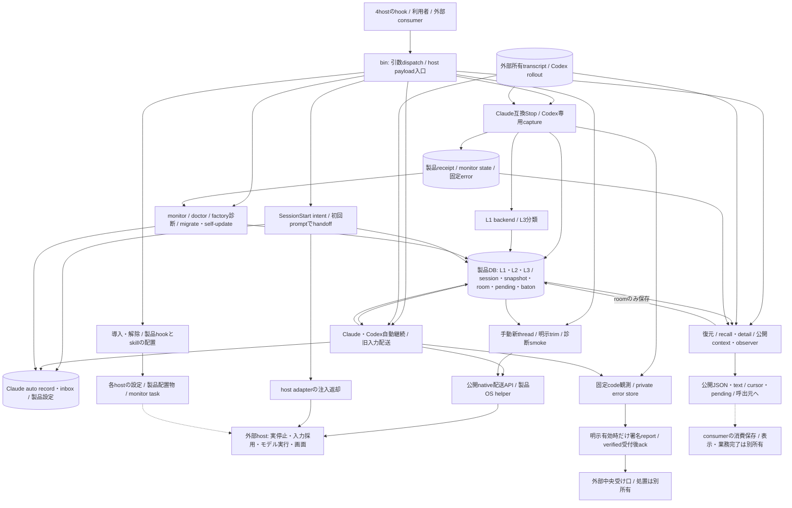

# Throughline 機能図とsource対応

状態: 全体リファクタリングの初期調査。base `39ff812d46c0e84e8fc1418096c509551cf3928b`。図/コードの全体整合や責務整理は未完。

- [未読台帳](unread-ledger.md): baseのtracked全417file。source126/test99/documentation141/config-support51を機械分類した。fixtureや各設定の意味の分類は未調査で、51件に含まれる可能性を個別に確認する。
- [bytes/SHAと宣言候補](file-inventory.json): 宣言行の文字列索引は部分的な手掛かりで、実関数や全callerの網羅を保証しない。全fileのsemanticMappingCompleteはfalse。
- [今回読んだ入口と記録・引継ぎの現行図](current-entrypoints.md): CLI/SessionStart/DB、初回handoff、Stopの保存/receipt/L1/L3、Codex専用capture/hookの3追加詳細図と実file/関数対応。未読callee/caller/testを明記する。新規図の実描画/目視とAstra確認はまだ行っていない。
- [自動継続・旧会話入力・OS起動](current-continuation.md): Claudeのrecord/accepted/inboxとCodexの停止準備/不変snapshot/mutation stage/公開配送APIを、成功/確定失敗/unknown/cleanupへ結ぶ。Grok手動継続とOS共通部品も対応付ける。実描画・全consumer閉包は未完。
- [文脈復元・observer・外部文脈](current-projections.md): 予算付きpush/pull、固定page/cursorと本文freshness、wait取消、auditor/caveat/roomをsourceへ結ぶ。observer現行図だけは既描画原稿/SVGを再利用し、残りの新図と全consumer閉包は未完。
- [手動継続・trim・app-server診断](current-manual-continuation.md): 新threadへの記憶注入とモデル開始、同threadのrollback/injectとdurable診断、通信中断/cleanupを区別する。自動継続の永続状態と異なる責任なので別詳細とし、既存図の内部を複製しない。未描画/全consumer閉包未了。
- [導入・監視・診断・更新・報告](current-lifecycle.md): 製品設定/信用と外部適用、複数fileの部分確定、readinessと実動作、送信受付/ack/解決を4現行図と実関数へ結ぶ。既存詳細と所有が異なる製品寿命/運用入口を一か所に置く。未描画/全consumer閉包未了。
- 既存設計の索引は[docs/00_overview.md](../00_overview.md)、記録/復元の既存図は[README](../../README.md#three-layer-memory-model)、Codex継続は[docs/05](../05_codex_first_roadmap.md)。有効な図を作り直さず、対応を確認して再利用する。

## 全体で埋める機能

導入/host登録、4host記録、DB/schema/競合、記憶/要約/再注入、Claude継続、Codex継続/trim、Grok/Cursor継続、usage/monitor、observer、外部文脈projection、診断/更新/エラー報告を調べる。これは調査順序であり、責務分割の確定案ではない。
各機能は実file/関数・状態/所有・caller・test/fixture/config/export・正常/失敗/停止/取消/不明/cleanupまで結ぶ。部分図の完成を全体完成へ補完しない。

## 現行の全体接続

現行sourceを辿る概略で、新しいmodule分割案ではない。実描画/目視・全接続照合は未完。線は複数fileを一括commitする意味ではなく、破線は外部適用/consumerの証明範囲を分ける。Codex自動継続の台帳はDB、Claude record/inboxはprivate fileという違いを詳細へ残す。receipt・monitor state・固定errorは別の保存先で、図の一ノードへの併記を同じstateの所有/確定境界とは扱わない。
記録/初回は[current-entrypoints](current-entrypoints.md)、自動継続/OSは[current-continuation](current-continuation.md)、投影は[current-projections](current-projections.md)、手動nativeは[current-manual-continuation](current-manual-continuation.md)、導入/運用と個別storeは[current-lifecycle](current-lifecycle.md)を詳細正本とする。実関数と失敗/取消/unknown/cleanupは各表を辿り、欠けるものは未読台帳と次の意味調査に残す。

## 保持する外部契約

CLI名/引数/JSON schema/exit/stdout/stderr、ClaudeとCodex/Grok/Cursorのhost別hook形、記憶/receipt/cursor/baton/後継と設定信用、保存/移行とreport/ackの意味を保つ。既読だけで保持済みとはせず、全callerと関連試験へ結ぶ。
observer新batch APIはこの候補の構造整理に含めない。実DB/稼働会話/他製品/OSを変更せず、公開・配布・本番反映は既条件に従う。

## 次工程

Sol Highで未読sourceを埋め、現在図を詳細化する。責務/接続/代替案の設計はAstra xhighの適用後、実装はSol、最終整合はAstraで行う。新しい整理の採否はまだ決めていない。

機械分類source126file（fixture4を含む）の本文確認は済んだ。これは全機能の意味調査・全caller/test/fixture/config/exportの照合完了ではない。次は未読の関連試験・設定/配布入口・現行正本と外部consumerを調べ、図から実関数/状態/返却までの不足を埋める。

最初のsource調査追補時点は本文58file（機械役割source47/test9/doc1/config1）、同blob参照1、未読358。以降の現在値は未読台帳を正本とする。source分類のうち現在4件は本文からfixtureと確認した。全fileの依存/consumer閉包は未了。各source調査でbase417fileのSHAを再照合し、実装/既存設定の変更0を確認する。関連testは本文読取だけで未実行。
