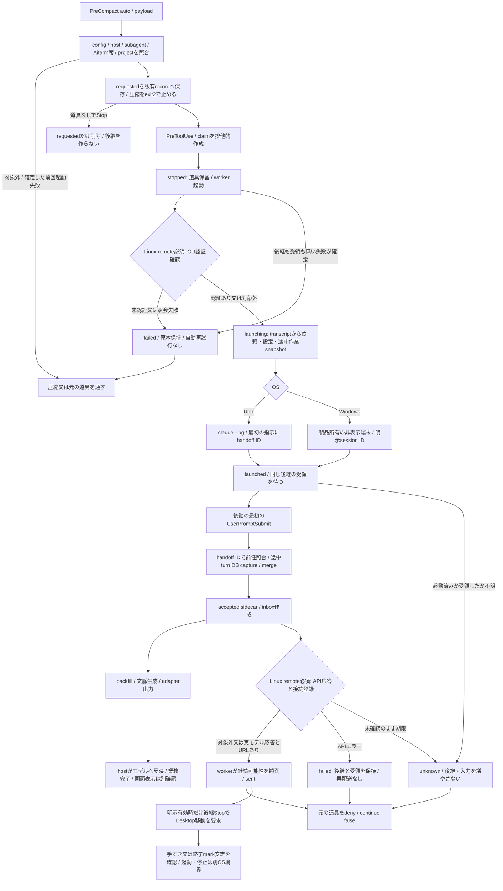
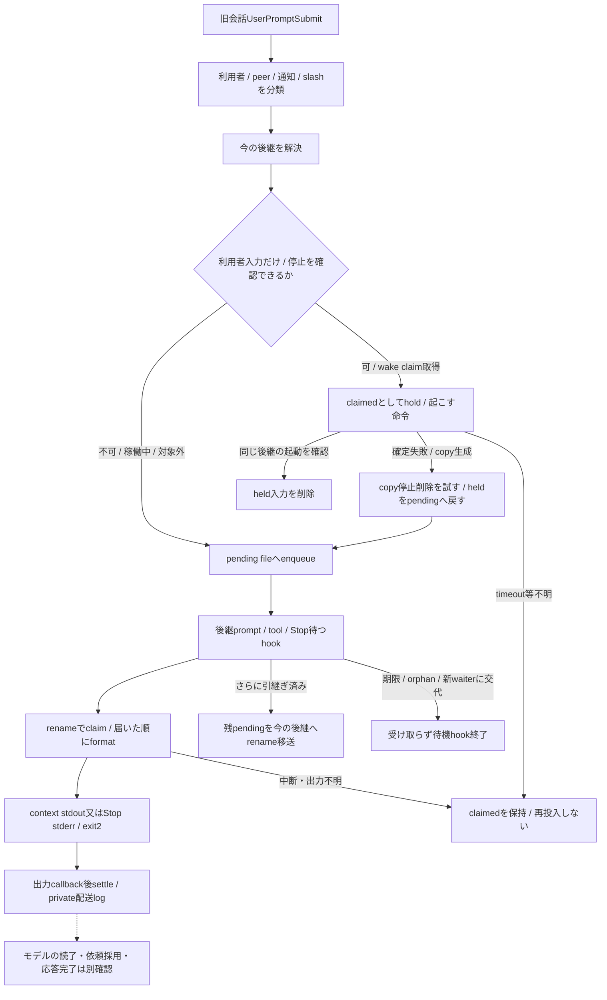
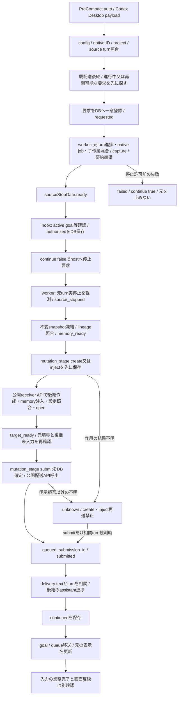

# 自動継続・旧会話入力・OS起動の現行source対応

基準base `39ff812d46c0e84e8fc1418096c509551cf3928b`、S1実装後の現行対応。[全体索引と現在の工程](README.md)から本詳細を経て実file/関数へ辿る。上段のsource調査時点の未読/未実行と、末尾のS1/S2/S3追補・保持根拠を区別する。[描画manifest](render-manifest.json)の原稿/描画物対応は固定し、意味が変わらない図を反復描画しない。適用済みAstraの最終照合結果は[全体索引末尾のS5](README.md#s5最終整合2026-11-03適用済みastra-xhigh)へ固定した。3OS全件/gateと指導担当の全体成果受入は完了。通常保守への引継ぎは全体索引末尾を参照。

## Claude: 停止許可・起動・受領・表示は別の状態

recordは製品所有の `claude-auto-handoff` 私有file。acceptedは後継hookが別fileへ書き、workerのrecord書換との衝突を避ける。claimは並行PreToolUseからworkerを一つだけ起こすための印。新しい取消APIはなく、requestedの取下げ、有限待ちの期限、外部終了を区別する。

`sent`は後継の最初の入力を受領した意味。acceptedはmerge後、backfill/文脈生成/adapter出力より前に書かれるため、注入完了・業務完了・画面反映と同じ意味にしない。途中turnのDB確定はworkerの起動前ではなく、実際の後継の最初の入力で行う。起動失敗で元会話が続く時に途中本文を先に凍結しない。

| source / 関数 | 責任・入力と作用 | 失敗/不明/cleanup・保持事項 |
| --- | --- | --- |
| [claude-pre-compact](../../src/claude-pre-compact.mjs):run / [claude-pre-tool-use](../../src/claude-pre-tool-use.mjs):run/reportFailure | stdin EOF、hook payload、最小file存在check→必要時だけ本体import。PreCompactはblockをexit2、PreToolUseはdeny又はcontinueをJSON返却 | subagent/対象外を通す。入口例外は固定runtime code＋私有log＋exit1。軽量入口の重複path/ID定数は観測で、統合採否は未定 |
| [claude-auto-handoff](../../src/claude-auto-handoff.mjs):requestClaudeAutoHandoff/isAitermSeatConversation/stopClaudeTurnForHandoff | config/project/host/既存recordを照合、requested→stoppedとclaim、worker起動、受領又は失敗を最大210秒待つ | Aitermはlaunch印だけでなくvendor session ID一致で席を除外。確定失敗で元を通し、unknownで重複起動しない。設定変更だけで進行中の所有を消さない |
| 同:runClaudeAutoHandoffWorker/findClaudeAutoContinuationSource/acceptClaudeAutoContinuation | stopped→launching→launched→sent/failed/unknown。model/effort/permission/projectを運び、後継の初回入力で前任を照合しDB capture/mergeへつなぐ | Windows terminal起動済み/終了/遅い受領を同じ端末で観測。Unix remote-controlなし再試行は起動無しを確かめた枝だけ。timeoutは再送許可ではない |
| 同:completeClaudeTurnWithoutHandoff/readClaudeAutoHandoff/listClaudeAutoHandoffs/publicClaudeAutoHandoff/resolveClaudeAutoHandoffSuccessor | requestedだけ取下げ、私有record→公開fieldへ投影、現在の後継/chain/pendingを返す。途中本文/設定は公開statusへ出さない | 24h掃除でも後継が残るrecordを保持。循環/最大200段を止める。read系のうちcleanupを行う入口と純粋な照会を区別 |
| 同:snapshotInFlight/readInFlightSteps/readRunningBackgroundTasks/captureStoppedTurn | 元依頼・最終本文・実行済み/止めた道具・未完background作業を私有snapshot化し、途中turnの取得参照を残す | 件数/文字数を制限し、捕捉失敗はlog＋turn=null。途中turnを完了扱いしない。source内の古い説明と実際の捕捉時機を混同しない |
| 同:requestClaudeDesktopOpen/runClaudeDesktopOpen/readFinishedTurnMark | 明示env有効時だけ後継Stop→別process。idle又はwaitingで終了markが2回安定→stop→Desktop resume | 既定OFF、後続handoff中ならsuperseded。idle未確認なら止めず次Stopへ。openの終了値/告知と画面反映は別確認 |
| [Claude config](../../src/claude-auto-handoff-config.mjs):readClaudeAutoHandoffConfig/writeClaudeAutoHandoffConfig/claudeAutoHandoffEnabledFor | 未存在はdisabled、schemaと絶対projectを検証、private temp→renameで書換 | Codex configとは別schema/file。両configの似た処理は観測のみで新helperへ統合していない。temp書込/rename失敗の後始末も保持調査対象 |

## Claude: 旧会話入力の配送と結果不明

所有は製品のinbox。pending、claimed、長文full、waiter、wakingを別stateとして扱う。claimedは1分より前なら公開unknown件数に数えるが、pendingへ自動復帰しない。context経路は9000字に届く順のprefixだけ、Stopは長文1件60000字超で頭とfull参照へし、full保存失敗時は既存の切詰め動作を持つ。入力は7日、指されない空inboxは24hという既存保持期限を勝手に変えない。

| source / 関数 | 状態/返却/副作用 | 停止/取消/部分失敗/不明 |
| --- | --- | --- |
| [claude-forward](../../src/claude-forward.mjs):claudeForwardKind/enqueueClaudeForward/holdClaudeForward/claimClaudeForwards/settleClaudeForwards/takeClaudeForwardsAsContext | pending→claimedのrename所有、明示settle/release、本文とpeer/通知の区別。出力後のdoneで削除 | 出力前後の強制終了でclaimedが残る。出力callbackはhost読了/モデル採用の証明ではない。全件transactionではなく1件毎にclaimする |
| 同:acquireClaudeWakeClaim/registerClaudeForwardWaiter/currentClaudeForwardWaiter/claudeForwardWaiterAlive/moveClaudeForwards/removeStaleClaudeForwards/readClaudeForwardStatus | wake claim60秒、waiter交代、pending移送、TTL掃除/公開件数 | 交代/orphan/deadlineで待機終了。古いunknownの自動再送なし。移送失敗は個別に残す |
| [claude-forward-wait](../../src/claude-forward-wait.mjs):waitForClaudeForwards/run | inboxがある対象だけ最大1日弱poll、claim→stderr書切り→settle→exit2。SDK/subagentは待たない | POSIX SIGTERMは143とlog、Windows強制終了でlogを保証しない。親process存在と新waiterを観測、AbortSignal引数は無い |
| [claude-auto-handoff](../../src/claude-auto-handoff.mjs):redirectClaudeHandedOffPrompt/wakeStoppedClaudeSuccessor/readClaudeSessionStopped/claudeWakeTextAllowed | stopped/doneでpid/statusの無い同じsessionだけwake。利用者入力だけ、12000字/NUL制限、最近書込/desktop/既存handoffを除外 | wake不明は再投入しない。copy生成時のstop/rmは呼ぶが戻り値を完了保証にしない。元会話へはblock理由を返す |
| [記憶側](../../src/claude-forward.mjs):unwrapClaudeForwardedDelivery/claudeForwardCarriesHumanInput / [transcript](../../src/transcript-reader.mjs):readTranscript | 受け渡した人/peer入力を記憶へ含め、通知だけを人の依頼へ補完しない | 記憶への保存、モデルの依頼採用、業務完了を別にする。mark/section本文のconsumer契約を保持 |

## Codex: 製品DBと外部配送窓口

状態所有は製品DBのcodex_handoffs、snapshotとsummary cache。配送・ネイティブ操作は外部製品 `aiterm-steer-delivery` の公開 `withCodexReceiver`、`verifyCodexParent`、`submitCodexParentAnswer` を利用する。相手内部を編集・私有参照しない。元の停止許可前はmemory準備だけで、後継作成・画面操作・goal停止・配送を行わない。停止要求を返した事実だけで元turnの実停止を補完しない。

| source / 関数 | 責任/保持状態/返却 | 失敗・不明・cleanup |
| --- | --- | --- |
| [codex-auto-handoff](../../src/codex-auto-handoff.mjs):requestCodexAutoHandoff/codexHandoffRequestFailureResult/waitForCodexHandoffPreparation/checkAutoHandoffSourceGoal | 対象照合、既要求/既後継優先、一意要求、準備readyとauthorized。例外時はread-only DBで既作用なしを確認できた時だけ元を通す | DB不在と読取不能/未知schemaを区別。内部auto-compactは圧縮だけ停止、未記録会話はskip。別要求を増やさない |
| 同:runAutoHandoffWorker/sourceBoundary/waitForHandoff/createTarget/targetState | PID+開始identityでworker claim。要求→元実停止→snapshot→準備後継→配送受付→相関進捗。各native作用前にmutation_stageを保存 | unknown再開はsubmitの観測だけ。create/injectを再送しない。明示receiver拒否は未作用としてstage解除。finallyで自分のworker claimだけrelease |
| 同:carryAutoHandoffQueue/pauseAutoHandoffSourceGoal/carryAutoHandoffGoal/settleAutoHandoffSourceGoal | 本引継ぎ後の独立作用。queue add前moving保存→成功moved保存→source delete。goal予算残量/active・pausedを維持 | movingが残ったらunknown化し再送せず元queueに残す。明示拒否はleft。失敗でcontinuedを取り消さない。page cap等既制限を確認対象へ残す |
| 同:findLiveAutoHandoffSuccessor/resolveAutoHandoffSuccessor/autoHandoffTargetName/markAutoHandoffSource/markAutoHandoffSources | 現在の後継・pending・表示名を照会/投影。人の旧入力と内部goal入力の画面操作を区別 | 既配達の後継を再生成しない。名前の失敗は本引継ぎを失敗へ補完しない。最大深さ/古い多枝は既制限 |
| [store](../../src/codex-auto-handoff-store.mjs):requestAutoHandoff/updateAutoHandoff/failAutoHandoff/claimAutoHandoff/releaseAutoHandoff | source thread/turn一意、mutable field whitelist、snapshot不変、expectedState/CAS、再開元状態 | freezeCodexMemoryは元capture projectと停止境界、後続の入力だけturnを除外。loadFrozenLineageは循環/欠落/各辺projectを検証。個別APIをDB全体transactionと誤解しない |
| [memory](../../src/codex-auto-handoff-memory.mjs):collectAutoHandoffMemory/ensureAutoHandoffSummaries/renderAutoHandoffMemory/renderFrozenDetail | lineageをorigin/turn/roleで集約、直近20turn全文＋古いL1、不変snapshotのL3取得参照。summaryはsource hashでcache | 制御文を表示から除いてもsnapshotから消さない。継承不能な前史は120000字まで明示切詰め。L1不足はthrow、実backend未起動 |
| [Codex config](../../src/codex-auto-handoff-config.mjs):readAutoHandoffConfig/writeAutoHandoffConfig/autoHandoffEnabledFor | Codex専用file/schema、openHost desktop限定、未存在disabled | Claude設定を連動変更しない。入力検証/temp→rename契約を保持 |
| [CLI](../../src/cli/auto-handoff.mjs):parseAutoHandoffArgs/enableAutoHandoff/enableClaudeAutoHandoff/publicOperation/run | enable/disable/status/resume/detail/worker/successor等のhost別制約、公開field、JSON/exit。status/detailはread-only DBをclose | Claudeはresumeを供給しない。Codex enableは公開hook登録/信用確認後config保存。設定/信用変更は本調査では実行しない。install側は[導入詳細](current-lifecycle.md)へ接続、全consumer閉包は未完 |

## OS境界と既存共通部品

| source / 関数 | 製品が所有する範囲 | 未確認/保持契約 |
| --- | --- | --- |
| [claude-terminal](../../src/os/claude-terminal.mjs):startClaudeTerminal/readClaudeTerminalRemoteControl/startWindowsClaudeWorker | hidden PTY、明示session、capability query応答、ended観測。WMIはenvをstdinで運びbootstrapへ秘密を埋めない。URLは同sessionの登録だけ | batch-only shimを拒否。WMI不明時はbootstrapと不明結果を保持、明確な未起動だけ片付け。host共有daemon/OSは触らない |
| [windows-terminal-runtime](../../src/os/windows-terminal-runtime.mjs):prepareWindowsTerminalRuntime/loadWindowsTerminalRuntime | package content hashの不変copy。live addonをnpm更新から分離し、copy/hash検証後rename。pending copyはfinally削除 | 既存仕組みを再実装しない。node-pty実起動/Windows実受入未実施 |
| [windows-package-update](../../src/os/windows-package-update.mjs):packageFiles/packagePathsOverlap/promoteWindowsPackage/updateWindowsPackage | symlink/特殊file/重なり/entrypoint変更拒否、変化fileだけ昇格、package.json最後、journal原本とrollback | rollback失敗ではlock/journal保持。native DLLのrenameを避ける既整理。source本文読取だけでself-update全体の受入とはしない |
| [portable-spawn](../../src/os/portable-spawn-sync.mjs):portableInvocation/spawnPortableSync/spawnPortable / [shell](../../src/os/shell.mjs):shQuote/appleString/nodeCliCommand | OSのargv/quoting/UTF8/shell=falseの既存正本 | shell/PowerShell/AppleScript境界を独自に増設しない。外部process cancelはcaller責任 |
| [pty-run](../../src/os/pty-run.mjs):runWithPty / [codex-runtime](../../src/os/codex-runtime.mjs):resolveCodexRuntime / [open-url](../../src/os/open-url.mjs):openUrlWithOsHandler | OS別のPTY、Windows Desktop実体選択、URL handler呼出。明示override、候補不在/複数を区別 | URL handler終了0は画面反映の証明ではない。PTY Windows出力不可、他OS未対応null等の返却を維持 |
| [macos-terminal](../../src/os/macos-terminal.mjs):appleScriptForTerminalExec/runTerminalScriptDetached/runTerminalDoScript / [grok-continue](../../src/cli/grok-continue.mjs):run/buildContinuePlan/writeLaunchArtifacts | Grokはread-only公開context→新sessionの最初の指示→macOS Terminal起動。rules不使用、対象外OSは明示失敗 | detached起動受付とGrokの記憶読了/応答を区別。prompt/launch一時fileの後始末は現行この関数内に無く、関連試験/consumerと保持要否を調査する |
| [title](../../src/auto-handoff-title.mjs):composeAutoHandoffTitle/markHandedOffTitle/autoHandoffSummaryOf / [hook log](../../src/hook-failure-log.mjs):logHookFailure | 名前はAIを呼ばず既titleから生成。詳細エラーは端末内log、固定runtime aggregateと分離 | unicode/制御文字/引用/重複印を保持。log本文を公開runtime診断へ流さない |
| [Codex手動projection](../../src/codex-handoff.mjs):renderCodexActiveWorkContext/renderCodexNewThreadHandoff/toCodexDeveloperMessageItem/toThroughlineHandoffBlock | 既handoff recordをtext/developer item/versioned JSONへ投影。自動継続memoryとは別表現で、任意memo/thinking/L1/L2とL3参照を扱う | record生成とCLIは[復元詳細](current-projections.md)へ。下流manual起動/trim本体は[手動詳細](current-manual-continuation.md)へ。全caller閉包は未完。maxDetailRefsは互換検証を残し、描画では使わない。生成はhostへの配送・読了を意味しない |

本文確認済みtestはtitle、Claude forward、OSのterminal/runtime/URL/PTY/Windows package/portable spawnに加え、claude-auto-handoff本体の全1912行。全て未実行。Codex自動継続本体の大きなtest・hook統合fixture・外部consumer閉包は未読/未完のまま。install設定/skillの確認は運用詳細へ接続する。構造上の整理候補はconfig/atomic writerの類似、各orchestrator内の複数責任、既存helperとの接続であり、採否・代替案はAstraで設計する。

### 自動継続の保持根拠と未検証境界

[claude-auto-handoff.test](../../src/claude-auto-handoff.test.mjs)はrequest/stop/worker/受領/今の後継/旧入力redirect/Desktop移動/Windows端末を、仮transcript・private file・in-memory DB・注入したspawn/terminal/pty/workerで確認する。CLI統合caseもtemporary homeと即失敗するfake Claudeを用いる。本文を読んだだけであり、今回の実harness受入ではない。

| source責任/既図の段 | 本文確認したassert・fixture | 保持/未確認 |
| --- | --- | --- |
| request/有効性・project/本人性 | relocated/worktree登録とCLAUDE_PROJECT_DIR、Windows path、手動/subagent/SDK/席本人の除外、席の残requested/failed取下げ、後継付きrecord保持 | 予約したprojectの印で別会話へ記憶を渡さず、handoff IDと後継IDで束縛。保持期限でも生きた後継があるrecordは消さない |
| claim→道具保留→受領又は確定失敗 | 並列道具でworker1回、起動IDだけでは返さない、失敗なら最初の両道具を通し途中本文を凍結しない、受領/unknownではdeny、期限はunknown | [ADR0067](../adr/0067-claude-failed-handoff-releases-source.md)/[0068](../adr/0068-claude-waits-before-stopping-source.md)が[0033](../adr/0033-claude-auto-handoff-new-session.md)の古いretry/事前captureを更新する。既結果を一律throw/再送へ変えない |
| snapshot/後継起動/accepted | 依頼と元設定/effort・title・未実行tool/既実行tool/backgroundの区別、後継入力でcapture、独立accepted原本とworker原本の競合防止、異常exitより受領を優先 | 受領はmerge/backfill後の全文注入成功を意味しない。DB捕捉失敗でも後継を立てた既結果とin_flight_captured=falseを隠さない |
| source保持/unknown | CLI不在と確定拒否はfailed、timeout/ID付き異常/受領期限切れはunknown、同じ後継を立て直さない、公開statusへ本文/pathを出さない | remote-control無しretryも未起動の枝に限る。実hostの現在の動作を仮spawnの結果から補完しない |
| DesktopとWindows端末寿命 | 既定OFF/明示有効、終了mark2回安定・busy/後続入力/queued等の拒否、先へのhandoffでsuperseded、Windows terminal失敗/終了/遅い受領とlate write防止 | UI handler/pty出口のopenedと実画面は別。Windows bootstrap取消job外の所有は注入callbackのassertでありOS実測ではない |
| 旧会話redirect/返却 | 後継実在・本人/別会話、pending転送、相関chain、同じ入力を二重出力しない、停止時はDBを開かない、logへ本文を残さない | 配送文法はconsumer契約。長文/claim/TTL/停止後wakeの詳細は既forward testと追加関連fixtureへ。全経路のcoverage済みとはしない |

共通pathは[project-path](../../src/project-path.mjs):normalizeProjectPathForCompare/sameProjectPathが実在時realpath、解決不能時lexical、区切り/末尾とOS caseを扱い、[os/paths](../../src/os/paths.mjs):foldPathCaseForPlatform/isWin32PlatformがWindowsだけcase foldする。config/merge/capture/auto/手動CLI/receiptが利用し、state/無効refreshはos/pathsも直接使う。既存共通責任を再実装せず、機能固有の同一/子孫比較やSQL lower比較を根拠無くこの一関数へそろえない。同期path照会は外部fileの存在を見るが保存せず、公開cancelを持たない。

[ADR0070](../adr/0070-codex-memory-preparation-before-source-stop.md)はCodexの準備ready/authorize/元実停止と不変snapshot、active goal時の明示継続、worktreeのcapture project束縛を規定する。Claudeの受領前待機とは別契約であり共通stateへ単純統合しない。Codex本体testの保持照合は次工程。新しいbatch機能をこれらの整理に混ぜない。

## 今回利用した検査・fixtureのsource

`scripts/verify-docs.mjs:verifyDocs`は作業treeのMarkdownを再帰読取し、リンク実在/top-level分類/archive/stubを検証する。`scripts/verify-pack-markdown-links.mjs`はnpm packのdry-run/ignore-scriptsのfile集合と相対targetを照合する。`scripts/markdown-link-targets.mjs`は既存remark/unifiedとHTML属性の抽出であり、Mermaid図の構文・見た目は検査しない。開発用scriptは配布対象外なのでsource path/関数名で索引し、tarball内のリンクとして扱わない。3scriptの本文を確認し、今回の文書検査を図描画/目視の代わりにしない。

[test-env](../../src/test-env.mjs)は試験専用のthread環境除去/Windows fake実行adapter/16MiBの既定buffer、[test-temp-dir](../../src/test-temp-dir.mjs)は試験process exit時の一時dir掃除を持つ。製品runtimeではなくfixtureとして分類し、実harness起動の安全根拠やcancelの保証へ補完しない。本体testの実行/最終OS受入は未実施。

## S3追補1: Codex停止境界とunknownの保持根拠

既第3図の準備→許可→実停止→snapshot→mutation→配送→進捗を、実workerと本体試験の該当assertへ照合した。`src/codex-auto-handoff.test.mjs`は部分読取を維持し、全1768行の読了とはしない。

| 図の段・実関数 | 今回読んだassertと所有 | 保持/停止/取消/不明/cleanup |
| --- | --- | --- |
| sourceStopGate・requestCodexAutoHandoff/waitForCodexHandoffPreparation | gateFixtureの注入したworker、source、backend、native/goalのfixture。ready後だけauthorizedをCAS保存し、停止前snapshotは正規保存しない | 準備timeout/後着worker/準備中の取消/子開始/goal読取失敗は元を継続。遅れたreadyでauthorizedを復活させない。準備待ちは20秒、外部AbortSignal APIは無い |
| 実停止・sourceBoundary/runAutoHandoffWorker | 許可後もsource.stoppedAtを待ち、未停止ならgoal/後継/配送は0回。停止後は準備済み要約を再実行しない | 許可返却と実停止は別。後続turnの入力だけ/活動あり/未終了を区別するsourceBoundaryの既規則を保持 |
| 不変snapshot・collectAutoHandoffMemory/ensureAutoHandoffSummaries/renderFrozenDetail | A→B→Cの24turn中20turn本文/古い4L1、L3非注入、snapshot再設定拒否、元bodies削除後の凍結L3取得 | 元DB行と凍結詳細の所有を分ける。L3参照が取得可能であることを画面・モデルの読了へ補完しない |
| mutation_stage・runAutoHandoffWorker | create応答喪失はunknown/createのまま再作成0回。submit喪失はunknown/submitから相関turnを観測しcontinuedへ、再配送0回 | create/injectは再送しない。submitだけ実入力の相関で回復する。明示拒否だけstageを解除し、他の通信例外から未作用と判断しない |
| claimと後続作用 | pid+started_identityのclaim、一度continuedなら再実行で作成/配送を増やさない。goal/queue/名前はcontinued後 | finallyは自分のworker claimをrelease。外部thread/元DB/既配送はrollbackしない。強制終了でfinally実行は保証しない |

この追補に対応する9選択試験は隔離DBと注入依存で通過した。別にhandoff record/resume/公開context 27件、hook import/二相4件も通過。実Host・実モデル・本番DB・実配送runnerの受入へ補完しない。停止前の新しい取消窓口/汎用state machineを追加していない。

## S3追補2: 起動・配送文・storeの公開窓口

| 実file/関数 | 代表caller・責任/入出力 | 保持/失敗/停止/cleanup |
| --- | --- | --- |
| [Claude auto](../../src/claude-auto-handoff.mjs):launchClaudeAutoHandoffWorker/launchClaudeDesktopOpen | request/tool/Stop→製品CLI子をdetached起動しpidを返す。Windows workerは既OS所有者へ | session ID検証、private logのfdはfinally close、子はunref。spawn受付を後継受領/画面成功としない。Desktop有効性/手すき判定は上位に残す |
| 同:claudeContinuationInput | worker→handoff IDと未実行道具の実行・既完了操作の非重複を指示する固定文 | pure文字列。初回入力はfindClaudeAutoContinuationSourceの照合対象であり、この生成だけでDB mergeしない |
| [forward](../../src/claude-forward.mjs):claudeForwardInboxDir/ensureClaudeForwardInbox/logClaudeForward/hasPendingClaudeForwards/formatClaudeForwards | auto受領とforward hook→session束縛inbox、private dir作成、配送ログ、pending有無、種別付き本文 | 不正IDはnull/false。dir/log失敗は既best-effort、本文の配送をログ成否に束縛しない。human/peer/notificationを表示で分け、pending照会でclaim/settleしない |
| [Codex store](../../src/codex-auto-handoff-store.mjs):getAutoHandoff/findAutoHandoffForTarget/findAutoHandoffForTurn/listDeliveredAutoHandoffsForSource/listUndeliveredAutoHandoffsForSource/listContinuedAutoHandoffs/listAutoHandoffs | orchestrator/auto CLI/memory→DB rowのdecodeと既順序/絞込を返す | deliveredは送ったかもしれないsubmit stageも含む。未配送/continued一覧を同一視しない。query/JSON decode失敗はthrow、reader自体はDBを開閉/書込しない |
| 同:continuationInput | worker/host state照合→handoff ID＋delivery IDと継続指示の固定文 | pure文字列。相関/再送禁止の原文を改名・共通化しない。Claude文法とは別 |
| [Codex auto](../../src/codex-auto-handoff.mjs):launchAutoHandoffWorker/launchAutoHandoffGoalSettle | hook/CLI→worker/resume又はgoal整理子をdetached起動 | private log fdはfinally close。goalの間隔markerは起動前に書くためspawn失敗でも残り得る。marker/起動はgoal整理成功ではなく、子停止/外部取消APIを新設しない |
| 同:hookIdentityShape/untrackedInheritedMemory/autoHandoffSourceFallbackTitle | request診断/memory/名前→許可identity形、最大120000 code pointの既継承文、前任title | path/本文を公開診断へ無制限に出さない。切詰めをtruncated/元文字数で明示、元DBは消さない。default titleはstore lookupを使う |
| 同:nameAutoHandoffTarget/renderAutoHandoffFailure/showAutoHandoffFailure | worker→外部thread名、固定識別子/codeだけのHTMLとOS handler | name失敗は固定stderr/false、HTMLはescape、unknownや未停止許可には再開を案内しない。HTML/logは製品stateに残り、handler終了0を実画面と同一視しない |
| [title](../../src/auto-handoff-title.mjs):autoHandoffProjectName/usableAutoHandoffTitle | compose/mark helper→path末尾のproject名・利用可能な最初のtitle行 | 制御列/空行/自動継続指示を除く既規則。AI/保存/外部呼出無し |
| [Grok CLI](../../src/cli/grok-continue.mjs):buildGrokContinuePrompt/resolveGrokBin/buildGrokArgv/buildLaunchScript/defaultSpawnLaunch | run/buildContinuePlan→非空context、home/PATHの実行候補、session argv、引用済みshell script、既macOS Terminal起動 | 空context拒否/実体不在null、quoteはos/shell。生成はpure、defaultSpawnLaunchだけOS作用。保存artifactの残存と表示/読了の未確認は既表のまま |

ここで起動窓口を索引化したことは実子process/Host操作の実施を表さない。S1の新命令/診断moduleと旧CLI互換参照に変更は無く、新しい配送API/daemon/取消機構は追加していない。

試験専用の公開helperも製品runtimeと分ける。[receipt fixture](../../src/completed-turn-receipts-test-fixture.mjs):seedCompletedTurnReceiptStore は仮storeを作り、[ACL test helper](../../src/os/windows-acl-test-helper.mjs):applyWindowsPrivateAcl/verifyWindowsPrivateAcl は試験用のWindows ACL操作をguard付きで呼び、[test-temp-dir](../../src/test-temp-dir.mjs):testTempDir は仮dirとexit cleanupを提供する。製品のCLI/consumerから使う新APIへ昇格させず、外部取消や強制終了後のcleanup保証を付け足さない。

## Linux Desktop起点の認証事前確認（修理作業中）

Linuxでremote_control.wantedの引継ぎは、workerが後継を立てる前に同じcwdとsuccessorEnvで公開`claude auth status --json`を最大10秒で照会する。loggedIn=falseはhandoff_authentication_required、照会失敗/不明/不正JSONはhandoff_authentication_check_failedとしてfailedへ保存する。後継も受領も作らず、既failedWithoutSuccessor契約で元の道具と会話を継続する。認証情報は保存/出力しない。これは現CLI未認証の予防であり、起動後API認証失敗/リモート登録成立の検証と既存の後継の復旧は別途未完。

Linuxのremote必須起動が明示拒否され、後継IDも受領も無い時はremoteなしで再起動せずhandoff_remote_control_unavailableを保存して元の会話を継続する。結果不明時の再送禁止とMacの既再試行契約を保持する。

Linux remote必須の受領後は、同じ後継のtranscript末尾を最大1MiB読取り、isApiErrorMessageを実モデル進捗に数えない。認証APIエラーはhandoff_successor_authentication_failed、その他APIエラーはhandoff_successor_api_failedとして後継/受領を保持しfailedを記録する。実モデルassistantとremote接続URLの両方を観測した時だけsent。期限内に両方揃わなければunknown/handoff_successor_readiness_unconfirmed。受領済みの起動応答不明もLinux remote必須ではunknownとして、fail helperからsentへ抜けない。後継がある失敗/不明では元の仕事を同時に走らせず、hookへ継続未確認と返す。起動前の後継なしfailedだけ元を解放する。既API失敗会話の安全な復旧と本人画面の受入は、この自動判定とは別に必要。
