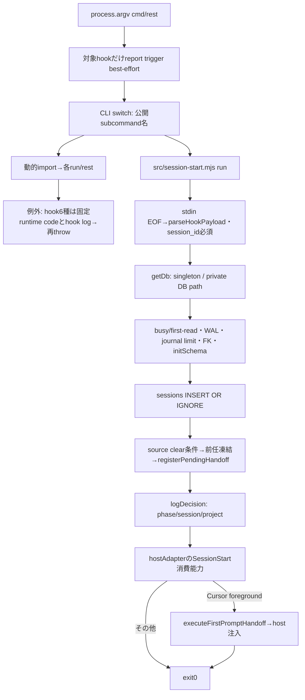
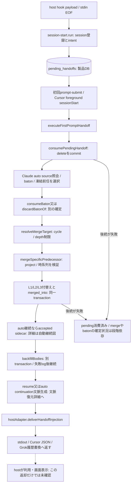
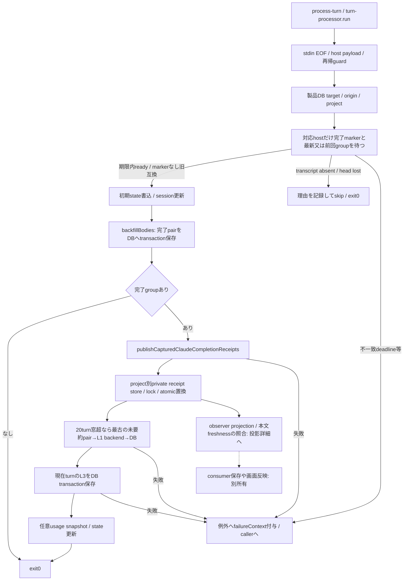
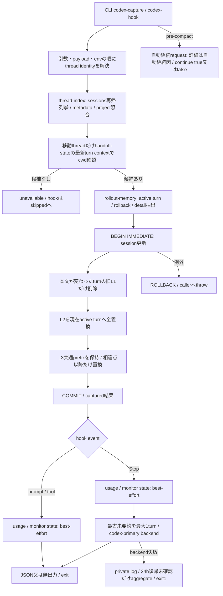

# source読取に対応する現行入口と記録・引継ぎ

基準base `39ff812d46c0e84e8fc1418096c509551cf3928b`、S1実装後の現行対応。[全体索引と現在の工程](README.md)から本詳細を経て実file/関数へ辿る。上段のsource調査時点の未読/未実行と、末尾のS1/S2/S3追補・保持根拠を区別する。[描画manifest](render-manifest.json)の原稿/描画物対応は固定し、意味が変わらない図を反復描画しない。適用済みAstraの最終整合と全体受入は未了。

monitor taskのprovisioningはgetDb後・sessions登録前に行われ、失敗はstderrへ書いて継続する。Cursorの注入未配送もstderrへ書く。実行入口のrun失敗はfixed runtime error/hook log/stderr/exit1となり、直接起動とCLI経由のcatchの関係は全callerで追跡が必要。図で単一の失敗処理へ統一済みとはしない。

| 実file/関数 | 確認した責務・状態・作用 | 残り |
| --- | --- | --- |
| bin/throughline.mjs | 公開CLIのdispatch/help、hook送信triggerと固定error補足、版/内部identity。package.jsonはbinと配布filesを定義 | 各runの入力/exit全体、全入口caller/試験/設定 |
| src/session-start.mjs:run | stdin EOF、必須session、DB session登録、前任intent、monitor task、log。Cursor foregroundだけ初回handoffと注入まで実行 | monitor provisioning、外部hook設定/callerと試験 |
| 同:findLatestClaudePredecessor | project/session条件のDB候補を読み、実在transcript又は保存stateで前任を選ぶ。Claude以外をprefix正本で除外 | path/大小文字比較の全契約、state/derive側の保持・失敗、関連fixture |
| src/db.mjs:getDb/initSchema/applySchemaMigrations | 製品私有DBのsingleton、WAL/timeout/journal limit/FK/schema0..12。migrationはBEGIN IMMEDIATE取得後にversionを再読し一括transaction、失敗rollback。接続初期化失敗でcloseしthrow | 全writer/readerとmigration fixture |
| 同:openReadOnlyDb/settleFirstRead | readOnly接続と最初のread再試行、失敗close | 全callerと実例外保持の試験 |
| 同:migrateDefaultDb/DatabaseMigrationError | 既存DBだけを移行、未存在はnot_applicable、future schemaは拒否、finally close | schema移行の全条件とCLI caller/試験/復旧 |

状態の正本は製品DB/製品state/hook payload、描画先/表示は各host/consumer。ここに停止/取消APIが追加されたわけではなく、同期DB待ち・stdin EOF・process.exitと外部取消の関係は未調査。部分成功を正常全体完了へ補完しない。

## 初回引継ぎの確定境界

この図は全体を一つのtransactionとして描かない。pending消費・baton消費・memory merge・backfillは独立しており、注入失敗時に先行確定を一括rollbackするコードではない。auto source照合/途中turn捕捉とaccepted sidecarは[自動継続の詳細](current-continuation.md)へ結ぶ。acceptedはbackfill/文脈生成/adapter出力より前であり、注入完了と同義ではない。文脈生成は[復元詳細](current-projections.md)、点線のhost表示は未検証。

| file/関数 | 所有/入力/副作用と返却 | 保持する条件・未確認 |
| --- | --- | --- |
| [pending-handoff](../../src/pending-handoff.mjs):registerPendingHandoff/consumePendingHandoff | intentを登録。consumeはBEGIN IMMEDIATE下でselect/delete/commitし、無ければnull。失敗rollback後throw | 幽霊sessionのintentをSessionStartだけでmergeへ進めない。消費後の後続失敗と再試行は別問題 |
| [baton](../../src/baton.mjs):writeBaton/consumeBaton/discardBatonOf | project単位upsert、bornAt基準TTL。未来batonを残し、期限超/有効なbatonをconsume時に削除 | 状態所有は製品DB。TTL・大小文字照合・未来保持を維持。後続の配送成功を保証しない |
| [handoff-executor](../../src/handoff-executor.mjs):executeFirstPromptHandoff | pendingを消費し、auto source→baton→凍結前任の選択とmerge/backfill/context生成を調停 | auto source/文脈復元の詳細へ接続。全caller testは未完。backfill失敗を記録し継続する既存動作を勝手に変更しない |
| [session-merger](../../src/session-merger.mjs):resolveMergeTarget/mergeSpecificPredecessor | cycle/depth、同project/時系列等を検証。3層rowを新sessionへ移し旧session.merged_into更新 | originは保持。L2 table不在の旧schema互換例外以外はrollback/throw。新側/既merge/自己mergeのno-opを保持 |
| [prompt-submit](../../src/prompt-submit.mjs):run/commandTextFromPrompt/isBatonCommand/isClearCommand/maybeRunPromptSpike | payload解析、引継ぎ/forwarded human入力、slash判定、batonとhost後処理。実験spikeのmarker/log/state/注入も同居 | 通常入口と実験機能の混在は整理候補の観測。採否はAstra設計で決める。自動継続/Grok起動先は自動継続詳細へ接続 |
| [host index](../../src/hosts/index.mjs):parseHookPayload/hostAdapterForSessionId | Grok/Cursor envelopeを正規化、4host adapterへ委譲。identityがprefix正本 | Codex専用hookは下節の別経路。Grok/Cursorのstate表現とClaude識別を同一視しない |
| [Grok注入](../../src/grok-history-inject.mjs):injectGrokHandoffContext | marker既存なら抑止。system_reminder行を最新user_query前へ挿入し履歴を書換 | stdout注入と異なる副作用。全file書換/書込失敗/consumer可視の境界を保持。実harness未確認 |

## Stop記録の確定順と部分成功

本文保存、完了receipt、L1、L3、最終stateは同時確定しない。L1/L3で失敗してもL2と公開済みreceiptを取り消す処理ではない。receiptは完了pairのidentity/hashであり、全機能完了・consumer消費・本文freshness・画面反映を代弁しない。共通Stopのreceipt laneにはGrok/Cursorも含まれ、observer v2で実harnessへ投影する。下節のCodex専用captureとは異なり、Codex完了chainはrolloutのtask_completeを根拠にする。[投影詳細](current-projections.md)へ接続する。

| file/関数 | 所有/入力/副作用と返却 | 保持する条件・未確認 |
| --- | --- | --- |
| [turn-processor](../../src/turn-processor.mjs):run/processStop/waitForClaudeStopTranscriptFlush | marker付きStopで2秒/25ms待ち。前回groupは未捕捉の場合だけ。先頭欠落/未存在skipを分類、他の期限失敗はthrow | 本文保存からreceipt→L1→L3の確定順。direct起動/CLI catchの関係と全hook fixtureは未完 |
| 同:isLogicalTurnCaptured/countDistinctBodyTurns/pickOldestUnsummarizedTurn | origin+turnの保存/要約判定。L2窓20、mergeを跨ぐoriginを保持 | 偶然同じ本文/同turn番号の別originを同一扱いしない |
| [turn-backfill](../../src/turn-backfill.mjs):backfillBodies/captureInFlightTurn | 完了pairは最後の断片番号で保存。Grok書換は内容比較と世代番号。in-flightは途中本文/L3を別transactionで保存 | 捕捉済み断片の冪等、欠落timestamp/queued入力、Grok世代のfixtureはまだ未読。in-flight保存を完了receiptへ補完しない |
| [transcript-reader](../../src/transcript-reader.mjs):readTranscript/getLogicalTurnGroups/readLatestLogicalTurnCompletions | hostメタと注入を除外し、queued/forwarded入力を結合、最後の非junk assistantを代表にする | 完了群・最新/前回群・L3抽出は別返却。全host fixture/callerは未完 |
| 同:readRawEntries/sliceCurrentTurnEntries/sliceInFlightTurnEntries/extractDetailBlocks | tool/thinking/image/attachmentのkind/source_idを作る。途中JSON行を無視、制御列を正規化 | source_idとoriginの保持を維持。thinkingはL3であり通常pushへ混ぜない |
| [receipt](../../src/completed-turn-receipts.mjs):writeCompletedTurnReceipt(s)/readCompletedTurnReceiptSnapshot | project正規化SHA、origin+user/assistant hashで冪等。256件上限・history floor・連続sequence。読取は新規file作成なし | 全入力検証→1projectのlock→temp/ACL→rename。lock60秒、finally rollback/close/temp除去。置換後の検証失敗は結果不明の余地を残す |
| [L1 backend](../../src/haiku-summarizer.mjs):summarizeToL1/resolveL1Ratio | model/effort/ratioを解釈、再帰guard。Claude-primaryとCodex-primaryで既存の失敗契約が異なる | Codex-primary失敗は明示。Claude-primaryの既存fallback順を維持。実backendは起動していない |
| [state](../../src/state-file.mjs):writeSessionState/readAllSessionStates/snapshotStateMtimes | monitor用私有state。読取で壊れたJSON/24h超を削除、15分でstale。snapshotはmtime取得 | readという名前でもcleanup副作用がある。project比較の別helperとの差、全monitor callerは未完 |

## 取消・停止・不明と既存の共通責務

ここまで読んだ同期DB/receipt関数にはAbortSignal等の公開取消引数がないため、その関数単体の取消APIは不適用。stdin EOF待ち・外部process killの中断、同期DB待ち、backend timeout、rename前後の結果不明を区別する。外部process中断時は既commitを全て戻す保証がなく、catch/finally到達も保証しない。後継processの停止/取消/配送unknownは[Claude/Codex自動継続とOS起動](current-continuation.md)へ接続し、外部配送内部/全consumer閉包は未完とする。

Windows ACLとOS別pathは、[os/windows-acl](../../src/os/windows-acl.mjs)と[os/app-dirs](../../src/os/app-dirs.mjs)に既に集約済み。この整理を再実装しない。ACLは15秒guard、private fileは別名でACL検証後hardlink公開、finallyでtempを除去する。[portable-spawn](../../src/os/portable-spawn-sync.mjs)もshell=false/Windows shim解決の既存正本を使う。OSへ実行はしていない。

[runtime-error-context](../../src/runtime-error-context.mjs)は固定enumと発生bindingだけを私有sidecarへ渡し、最新発生だけのmessageに投影する。raw payload/path/errorを公開診断に混ぜない。[送信trigger](../../src/runtime-error-report-trigger.mjs)は既定通信無効・best-effortでdetached子processを起こすだけで、受信完了を意味しない。store/report/ack/resolveの全体sourceは[製品寿命/運用入口](current-lifecycle.md)へ接続する。全consumer/試験照合は未完であり、この本文読取を診断機能の整合完了とはしない。

## caller・試験・fixture・設定/exportの確認範囲

pending→executor、executor→session-start/prompt-submit、baton→prompt-submit/executor、merge→executor/turn-processor/Claude auto、state→session-start/executor/turn-processor/Codex hook/monitorの参照を検索した。receipt→turn-processor/observer feed、backfill→handoff/Stop/Claude auto、L1→Stop/Codex summarize/auto memoryも参照検索済み。未読callerは未読のままとし、検索の省略表示を全件読了へ補完しない。

本文確認済みのtestはpending-handoff、baton、session-merger、prompt-submit、state-file、db-schema、hosts/identity、completed-turn-receipts、turn-processorの9file。実行していない。receipt seedとWindows ACL helperの2fixture本文を確認した。backfill/transcript/backend/hook統合/observerとmigration競合のfixtureは未了。設定/environment/exportと全callerの閉包も未了で、台帳のsemanticMappingCompleteを全件falseのまま維持する。

## Codex専用capture/hookの現行経路

Codex captureはClaude系appendとは異なり、現在のrolloutを正本としてL2全置換、L3は共通prefixを保持する。一つのDB transaction内で古くなったL1だけを除き、capture済みの後で要約が失敗しても取り込みは残る。`captured`は進行中turnも含み得る保存結果であり、完了turn receipt・後継の配送・画面反映を意味しない。通常prompt/tool hookのcurrent-thread refreshは無効のまま。

| file/関数 | 実sourceで確認した責任/状態/返却 | 残確認 |
| --- | --- | --- |
| [cli/codex-hook](../../src/cli/codex-hook.mjs):run/captureCodexHookSession/runCodexStopHook/runCodexUserPromptSubmitHook/runCodexPostToolUseHook/codexHookFailureCode | stdin EOFと引数を解析。sidecar guard、identity、capture、monitor、StopだけL1。pre-compactのcontinue=falseは停止返答でexit0、背景完了とは別 | request本体は自動継続詳細へ接続。設置設定/全hook test未読。no-op互換のautoRefresh引数と_internal exportを勝手に消さない |
| [codex-capture](../../src/codex-capture.mjs):captureCodexRolloutToDb/buildBodyRowsFromActiveTurns/buildDetailRowsFromActiveTurns/syncDetailRows | thread/project候補、移動contextの確認、DB transaction、detail source_id冪等/時刻保持。identityの旧import面を再export | 全caller/rollback fixture/export保持試験未読。session.project_pathの既存candidate.cwd選択も設計変更を混ぜず保持 |
| [rollout-memory](../../src/codex-rollout-memory.mjs):parseCodexRolloutFile/buildCodexRolloutTrimSource/inspectCodexPlannedRollbackRestoreSafety/compactCodexInternalContext | corrupt行を数えて継続、task/rollback/synthetic group、tool詳細、注入developer文脈の識別、内部goal定型文の圧縮。restore riskは診断として返す | active turnとcompletedAt、includeInFlightTurnの差を維持。restore safety=okを実reload安全証明へ補完しない。trim/restore全callerとfixture未了 |
| [thread-index](../../src/codex-thread-index.mjs):listCodexThreadCandidates/findCodexThreadCandidate/readSessionIndex | rollout再帰探索、先頭metadata最大64KiB、mtime順・project同一又は子孫候補。壊れたindex行は無視、file fdはfinally close | 他機能のpath比較正本との差は観測。統合helperへの採否は全caller/fixture確認後Astra設計へ |
| [thread-identity](../../src/codex-thread-identity.mjs):resolveCodexThreadIdentity | 明示引数→THROUGHLINE_CODEX_THREAD_ID→CODEX_THREAD_ID。hookはpayload識別子をenvより優先する | 順序を維持。設定/ホスト側callerは未読 |
| [handoff-state](../../src/hosts/codex-handoff-state.mjs):readCodexHandoffState/normalizeThreadSettings/settingsMatch/resolvePreparedSettings/threadStartSettings/toAppServerSandbox | 改行で確定したrowだけ読む。未確定末尾は除外、途中不正JSONはthrow。元/後続turn、停止/完了/進捗/入力種別、pending tool/native job、継承記憶と設定を観測 | 通常rollout parserと目的/不正行契約が異なるため、重複だからと統合しない。unknown/再送判断は自動継続詳細へ接続し、全caller/testは未完 |
| [codex-summarize](../../src/cli/codex-summarize.mjs):summarizeCodexSession/run | 20turn窓、origin+turnで最古L2をCodex backendへ渡しL1挿入。単独CLIのmaxとhookのmax1を区別 | backend失敗のraw診断と固定aggregateの経路、全試験/caller未了 |
| [codex-usage](../../src/codex-usage.mjs):readLatestCodexUsage/estimateCodexUsageFromRollout/buildCodexMonitorUsage | host token_countとlive outputを利用。無ければactive rollout文字数から見積り。usageは推定区別付きmonitor state | monitor/auto-handoff側の判断条件と全fixture未読。DB保存完了とhostのcontext圧縮を同一視しない |

CodexのL1 backend一回の失敗はhook logへ残し、復帰未確認が24時間に達した場合の固定aggregateと分ける。復帰時は実際にcodex-cli sourceの要約が返ったことを確認して記録を解決する。非zero/JSONエラー本文と公開固定診断の境界を保つ。ここまでのsource調査は実CLI/実rollout/実DBを使っていない。

## host adapterと記録側helperの対応追補

以下は既存図のCLI/adapter/記録ノードの実体を補う索引で、新しい責務分割案ではない。source本文は前段で読了済みだったが、fileへの直接リンクと全export名の対応に抜けがあったため追記する。静的import列挙は確認の補助で、動的呼出・公開CLI文字列・外部consumerの閉包を保証しない。

| 実file/関数・値 | 状態/入力→処理→返却・caller | 保持・失敗/取消/cleanup |
| --- | --- | --- |
| [hosts/identity](../../src/hosts/identity.mjs):hostOfSessionId/isCodexSessionId/isGrokSessionId/isCursorSessionId/buildCodexThroughlineSessionId/codexSessionIdToThreadId/grokBareSessionId/cursorBareSessionId、host/prefix/KNOWN_STATE_HOSTS | prefixだけで4harnessを区別。adapter選択、capture/observer/記録/投影/monitor/CLIから利用。state上の既知hostはClaude/Codexだけ | prefix無しClaude、Cursorのbc-除去、Grok/Cursorの互換state扱いを変更しない。純粋関数、保存/取消/後始末無し。新host推測を追加しない |
| [hosts/claude](../../src/hosts/claude.mjs):deriveClaudeTranscriptPath/compactClaudeTaskNotification/compactClaudePeerMessage/readClaudeRelocatedCwd/claudeHostAdapter | host registry→記録/初回注入、transcript/backfill/Claude autoから利用。projectはrelocated行→CLAUDE_PROJECT_DIR→cwd、stdoutへ文脈を返す | JSONの実relocated行を後ろから探す。tool本文の同文字列を移動と解釈せず、読取失敗はnull。通知の出力path/定型末尾だけを落とし、意味を持つ本文を保持。stdout書込はモデル利用/画面反映ではない |
| [hosts/codex](../../src/hosts/codex.mjs):codexHostAdapter | host registryの識別と、Claude互換入口へ流入した時の従来動作。専用captureは別のcodex-hook | completion project=cwd、flush待ち=true、追記前提、通常SessionStart消費=false、baton後起動無し。専用Codex経路の代替にはしない |
| [hosts/cursor](../../src/hosts/cursor.mjs):isCursorEnvelope/encodeCursorProjectDir/deriveCursorTranscriptPath/normalizeCursorHookPayload/cursorHostAdapter、内部cursorCwd/cursorRawSessionId | 既知event又はversionで判定、conversation_id優先、cwd又はworkspace_roots[0]、明示path又はslugからtranscriptを導出。SessionStartで消費しadditional_context JSON返却 | beforeSubmitPromptへ注入を移さない。rewrite未実測はfalseを維持、flush待ち無し。baton後の自動起動は無し。正規化はfile保存せず、出力後の外部取消を巻戻さない |
| [hosts/grok](../../src/hosts/grok.mjs):isGrokEnvelope/deriveGrokChatHistoryPath/normalizeGrokHookPayload/grokHostAdapter、内部lastUserPromptText、prefix/bare再export | camel/snake/envをClaude互換形へ。updatesではなくchat_historyを選び、commandは最新user本文でも確認。adapter注入はhistory更新、baton成功後tlだけgrok-continueへ | rewritesTranscript=true/flush待ち無し。history書換のdeliveredはliveモデル採用ではない。後継起動の成否は別CLI、外部host内部を所有しない。sourceの古いコメントを現行公開契約へ戻さない |
| [cli/codex-capture](../../src/cli/codex-capture.mjs):run、内部parseArgs/renderReport | bin→引数/identity→getDb→captureCodexRolloutToDb→JSON又はtext。成功status capturedだけexit0、明示project/home/IDを運ぶ | 引数/identity/本体例外はstderr+exit1、DB初期化作用がある。公開取消API無し。保存完了はtask完了ではない。identity source field/export/exit形を保持 |
| [turn-start](../../src/turn-start.mjs):classifyTurnStart/publicTurnStart、TURN_START_* | transcript-readerとobserverがuser行のhost印からprompt/self/unknownを投影。Claude scheduled印もself、Codexの判定は別sourceに残る | 旧NULL/未知はunknown、Cursor固定文だけ例外。本文の一般的な言い回しからselfを推測しない。pure分類でstateを進めない |
| [constants](../../src/constants.mjs):DETAIL_KIND/DETAIL_KIND_VALUES | transcript-reader/sc-detailがL3保存値/既知kind判定に使用。tool_input/output/system/image/thinking | Thinkingは既知kindであり、sc-detailに専用表示枝が無いこととは別。値の変更は保存済みDB/reader/testへ届くため、似た文字列を別定義へ分けない |
| [decision-log](../../src/decision-log.mjs):logDecision | SessionStart/prompt-submit/Claude pre hooks→製品private判定logへJSONL追記。phaseで入口を分ける | log失敗はstderrへ出し、元操作へthrowしない既契約。追記はDB/受領と別作用、同期APIにcancel無し。生の例外を固定runtime公開schemaへ混ぜない |

[completed-turn-receipts-test-fixture](../../src/completed-turn-receipts-test-fixture.mjs)と[windows-acl-test-helper](../../src/os/windows-acl-test-helper.mjs)は本文確認済みの試験専用fixture。前者はreceipt/observer test、後者はreceipt/runtime-error store/hook testから使われる。製品公開APIや実DB/Host受入用の入口に昇格させない。test-env/test-temp-dirも[自動継続詳細](current-continuation.md)の試験専用部品に属する。

[ADR0014](../adr/0014-two-phase-handoff-ghost-baton.md)の二相所有/bornAt基準baton TTL/future baton保持と、[ADR0065](../adr/0065-claude-scheduled-task-turn-and-stored-receipt-number.md)のscheduled self分類/保存済み群の実番号での受領を確認した。後から断片が増えて群の代表番号が動いても既保存本文を無断置換せず、受領は実在する保存番号へ結ぶ。[ADR0056](../adr/0056-grok-rewritten-chat-history-keeps-captured-turns-apart.md)のGrok世代/位置+本文照合は別契約で、Claude/Cursorの位置だけの既判定を一律に変更しない。関連backfill/transcript/turn-start testの未読は台帳に残す。

## 次に読む順

1. 記録/引継ぎ/DB/host/Codex captureと自動継続/OSの本文確認は本図と自動継続図へ。関連試験/fixtureと全caller/設定/exportの閉包は未了。
2. resume/context/projection/observer、手動handoff/trim/app-serverのsource本文は各詳細へ接続済み。保持試験/fixtureと外部consumerを埋める。
3. 導入/診断/更新/報告/monitorのsourceと大きな導入/診断/表示testの本文は運用詳細へ接続済み。未確認の失敗/取消coverageを残す。
4. 各機能の全caller/試験/fixture/config/exportを索引へ戻し、Astra適用後に責務整理を設計する。

## S3追補1: hook入口の保持試験

[hook-entrypoints.test](../../src/hook-entrypoints.test.mjs)の1..86と473..684を追加確認し、import時の無作用と二相3件を選択して全4件通過した。仮HOME/XDG/stateと仮DBを使い、src直接起動でSessionStartのintentだけ→初回promptのbaton消費/merge/出力→2回目非注入、promptを持たない幽霊の非取得、走行中sessionのbaton非横取りをassertする。CLI動的dispatchとは別に、module末尾のdirect-run guardも通る接続である。S1で追加したhost moduleのimportも同じ無作用検査に入る。

全hook試験/全host fixtureは本文未読が残る。この4件を全hook/全OS/自然hook発火の証明にはしない。正常返却のstdoutはhost読了と別、pendingとmerge/出力の確定順は上の初回引継ぎ図を保持する。

## S3追補2: 記録helperの窓口と保持根拠

下表は既図のノード内にある公開helperを補い、別の保存先や責任を作らない。同期の分類/文字列生成は保存せず、取消APIとcleanupは不適用。file/DBを読む入口と、ログやreceiptを書き込む入口は分けて記す。

| 実file/関数 | 代表caller・入出力/所有 | 保持/失敗/検証 |
| --- | --- | --- |
| [transcript-reader](../../src/transcript-reader.mjs):isCompactSummaryEntry/isClaudeHostWrittenMetaEntry/isClaudeScheduledTaskPromptEntry/isGrokHostWrittenUserEntry/isJunkAssistantText | readTranscript/getLogicalTurnGroups/turn-start→hostメタ/圧縮要約/定型エラーの分類 | scheduled入力を一般メタとして捨てず、圧縮要約を人の依頼へ変換しない。前段の分類契約を保つpure判定 |
| 同:readLatestUserGroup/getLastTurn/getLastAssistantTurn/getLastTurnPair | Claude auto/processor/doctor→transcriptから最新user群/最終発言/直前pairを選ぶ | 同じ「最新」でも完了判定は別。本文不在はnullやnull pair、file読取/JSON処理はreadTranscriptへ。これらをreceipt生成へ転用しない |
| 同:normalizeTerminalText/normalizeToolResultContent | reader/capture→端末制御列/CRとtext-image配列の表示用正規化 | CR末尾断片、画像placeholder、非textの空文字を保持。元fileを変更しない |
| [hosts/index](../../src/hosts/index.mjs):normalizeHookPayload | parseHookPayload→envのGrok印優先、次にGrok/Cursor envelopeをadapterへ、他は元payload | hostの正規化だけ。DBや注入先を所有せず、無効JSON拒否はparseHookPayloadに残す |
| [thread-index](../../src/codex-thread-index.mjs):defaultCodexHome | capture/monitor/CLI→CODEX_HOME又はhome/.codex | pathの決定だけで実storeは開かない。明示homeを持つcallerの意味を変えない |
| [receipt](../../src/completed-turn-receipts.mjs):defaultCompletedTurnReceiptStorePath/writeCompletedTurnReceipts | processorの複数完了pair→同projectの私有storeへ一度のlock/置換 | 全入力を先に検証、空arrayは無作用、cross-projectを拒否、同pair冪等、sequence/256上限を保持。単件writeもこの所有者を使う |
| [backfill](../../src/turn-backfill.mjs):logBackfill | executor/processor→home/.throughline/logsへ追記 | ログ書込失敗はstderr、元のbackfill結果は取り消さない。同期APIにcancel無し、完了receipt/公開診断とは別 |
| [state-file](../../src/state-file.mjs):getStateDir | doctor/monitor/test→既module定数のstate保存先を返す | path返却でありfile作成ではない。readAllSessionStatesの期限切れcleanupは既表へ |

[codex-capture.test](../../src/codex-capture.test.mjs)全657行を照合した。rollback後のL2全置換、response_item/旧eventの重複除外、変化turnだけ旧L1削除、同じL3先頭のid/時刻保持、途中差込/同長本文変更/source_id重複/全消失が全再作成と同じ内容/順序になるfixtureを既図へ結ぶ。[codex-hook.test](../../src/cli/codex-hook.test.mjs)全593行を確認し、payload優先identity・monitor分離・75%でもrefresh非起動・backoff不使用・L1固有失敗codeを確認した。両試験の実行結果は先行Linux全件の成功記録を使い、今回再走していない。
