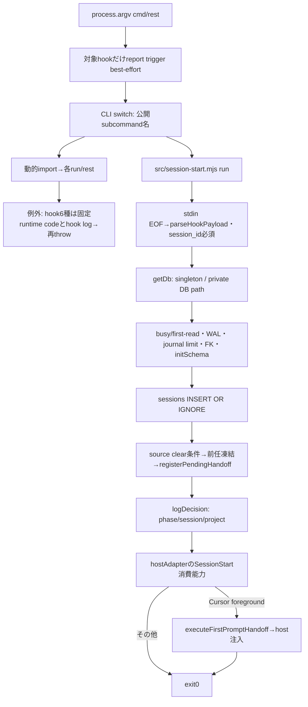

# 初回source読取に対応する現行入口

対象はbase39ff812のbin/throughline.mjs 1..280行、src/session-start.mjs全203行、src/db.mjs 1..100/410..500行とpackage.json。図は実読した流れの初稿で、未読部分の代用ではない。新APIや構造変更の提案を描いていない。まだ実描画/目視していない。

monitor taskのprovisioningはgetDb後・sessions登録前に行われ、失敗はstderrへ書いて継続する。Cursorの注入未配送もstderrへ書く。実行入口のrun失敗はfixed runtime error/hook log/stderr/exit1となり、直接起動とCLI経由のcatchの関係は全callerで追跡が必要。図で単一の失敗処理へ統一済みとはしない。

| 実file/関数 | 確認した責務・状態・作用 | 残り |
| --- | --- | --- |
| bin/throughline.mjs | 公開CLIのdispatch、hook送信triggerと固定error補足、版/内部identity。package.jsonはbinと配布filesを定義 | help281..447、各runの入力/exit全体、全入口caller/試験/設定 |
| src/session-start.mjs:run | stdin EOF、必須session、DB session登録、前任intent、monitor task、log。Cursor foregroundだけ初回handoffと注入まで実行 | parseHookPayload/adapter、pending/log/monitor/callerと試験 |
| 同:findLatestClaudePredecessor | project/session条件のDB候補を読み、実在transcript又は保存stateで前任を選ぶ。Claude以外をprefix正本で除外 | path/大小文字比較の全契約、state/derive側の保持・失敗、関連fixture |
| src/db.mjs:getDb | ~/.throughline/throughline.db作成・接続singleton、WAL/timeout/journal limit/FK/schema、初期化失敗でcloseしthrow | initSchemaの中段101..409、全writer/readerとmigration fixture |
| 同:openReadOnlyDb/settleFirstRead | readOnly接続と最初のread再試行、失敗close | 全callerと実例外保持の試験 |
| 同:migrateDefaultDb/DatabaseMigrationError | 既存DBだけを移行、未存在はnot_applicable、future schemaは拒否、finally close | schema移行の全条件とCLI caller/試験/復旧 |

状態の正本は製品DB/製品state/hook payload、描画先/表示は各host/consumer。ここに停止/取消APIが追加されたわけではなく、同期DB待ち・stdin EOF・process.exitと外部取消の関係は未調査。部分成功を正常全体完了へ補完しない。

## 次に読む順

1. prompt-submit/turn-processor/pending-handoff/handoff-executorとDB schema全体。
2. host adapter/identity、transcript/Codex capture・receiptと記憶/要約。
3. Claude/Codex継続・OS起動・停止/取消、全projection/observer、導入/診断/更新/報告。
4. 各機能の全caller/試験/fixture/config/exportを索引へ戻し、Astraで責務整理を設計する。
