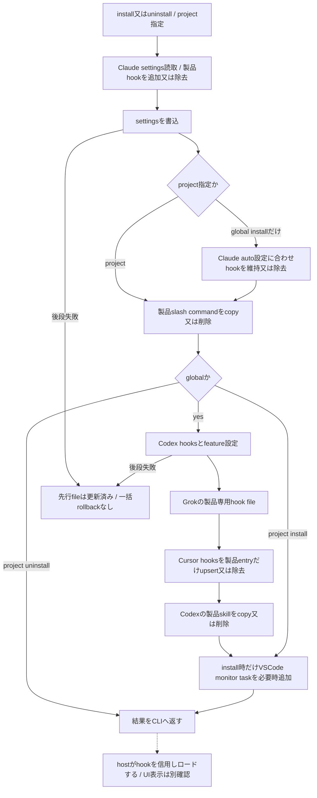
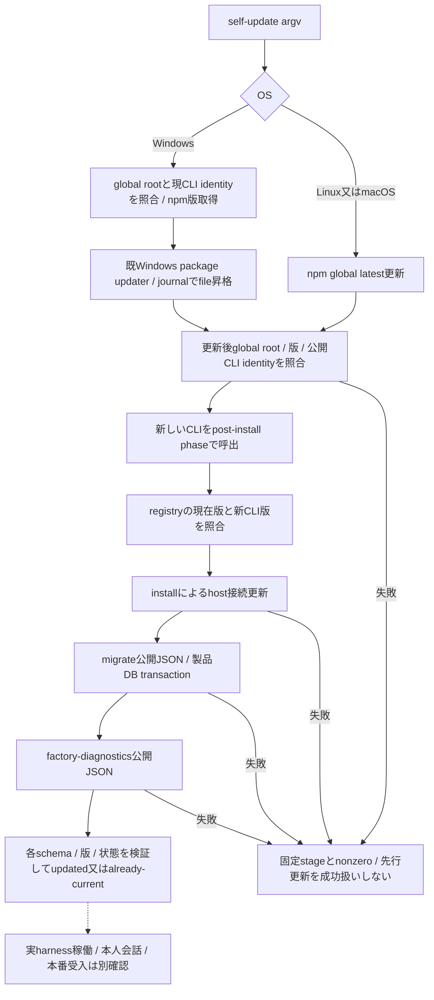
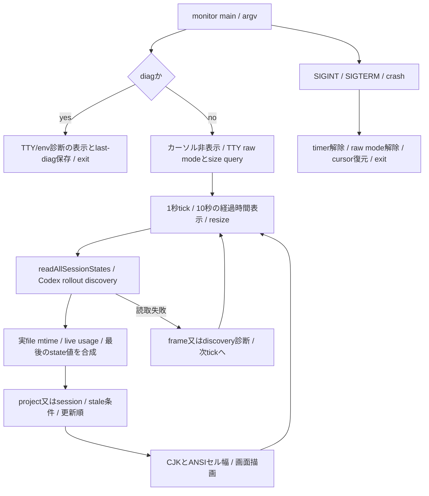
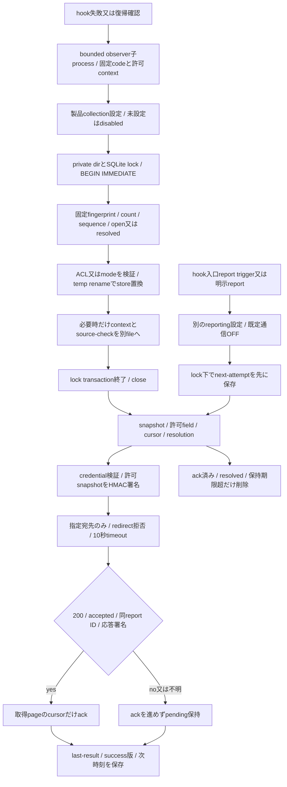

# 導入・監視・診断・更新・エラー報告の現行source対応

基準 `39ff812d46c0e84e8fc1418096c509551cf3928b`。[全体索引](README.md)→本詳細→実file/関数へ辿る。sourceの読取から得た現行図であり、責務整理案の採否・実装・実Host受入ではない。新4図は実描画/目視済みで[描画manifest](render-manifest.json)へ対応付けた。Astra最終整合は未了。ここまでで機械分類source126fileの本文を確認したが、fixture4を含む数であり、全test/config/export/consumerの照合は未完。

## 導入・解除と設定信用

図はfileごとの作用を表し、すべての書込がatomic又は一transactionではない。実コードのglobal順序はClaude settings/auto→commands→Codex hooks/config→Grok→Cursor→Codex skill→monitor taskである。uninstallはmonitor taskや記憶DBを消す処理ではない。製品が登録を書いたことと、hostが信用したこと・次の会話へ適用したことを区別する。

| 実file/関数 | 入力・所有・作用/返却 | 保持/失敗/未確認 |
| --- | --- | --- |
| [cli/install](../../src/cli/install.mjs):run/resolveSettingsPath/readSettings/writeSettings/installSlashCommands/uninstallSlashCommands/installCodexSkills/uninstallCodexSkills | project指定はClaudeだけ、globalは4hostと製品skill。既存settingsへ製品hookを追加し、配布内の固定2command/1skillを配置する | 複数fileの途中失敗は先行作用を戻さない。skillは既destを削除後copy。公開cancel無し、強制終了時に残る状態を成功へ補完しない |
| 同:resolveCodexHookNodePath/buildCodexHookCommand/parseCodexHookCommand/isEquivalentCodexHookCommand/registeredCodexHookCommand | 同じ実node/scriptをrealpathで照合。既登録が同実体なら命令文字列を保持し信用を不要に失効させない | Windowsの`&`、space/quote、PATHと実体の違いを保持。信用DB自体を書換える経路ではない |
| 同:createCodexHooks/installCodexHooks/ensureCodexHooksFeature/uninstallCodexHooks | 自製hookだけを置換/除去し他hookを保持、hooks featureを有効化し旧codex_hooks行を除く。Stop300秒、prompt/tool30秒、PreCompact30秒 | config/settingsは直接書込。uninstallはfeature全体を無効化しない。全fixtureの確認前に登録順を変えない |
| 同:installClaudeAutoHandoffHooks/removeClaudeAutoHandoffHooks/claudeAutoHandoffHooksRegistered/installCodexAutoHandoffHook | auto enable/disableから使うexport。Claudeは使用端末だけhook、既形は並び維持。Codexはauto PreCompact登録とfeatureを設定 | [自動継続](current-continuation.md)へ接続。登録・信用・enabled保存の確定位置は別。一般installと自動有効化を同一作用へまとめない |
| 同:createGrokHooksFile/installGrokHooks/uninstallGrokHooks/createCursorHookEntries/installCursorHooks/uninstallCursorHooks | Grokは製品専用fileを生成/削除。Cursorは共存fileから製品entryだけ置換/除去 | Grok専用fileとCursor共存fileの保持契約は異なる。Claude uninstallは製品commandを含むgroup単位で除去する現実装で、Codex/Cursorのentry単位と同じとは記述しない。混在fixtureは未照合 |
| [vscode-task](../../src/vscode-task.mjs):ensureMonitorTaskFile/detectJsoncFeatures/findMonitorTaskIndex/isMonitorTaskBroken/buildMonitorTask/atomicWrite | VSCode検知・opt-out・cwd/bin確認後、taskを新規/merge又は壊れた絶対pathだけrepair。user label/presentationを保持、JSONCには案内だけ | temp→renameはtask1fileの置換。temp失敗後の掃除はこのhelperに無い。案内markerとtaskは一括確定ではない。通知を抑止しても既markerを記録する枝を保持 |

hook側SessionStart/prompt-submitからのtask provisionも同じhelperへ接続する。実際のmonitor起動はVSCodeのfolderOpen/利用者操作が所有し、設定を書いた返却だけでは起動を確認できない。shell/commandの既OS部品を新しく作り直さない。

## 自己更新・移行・readiness

Windowsのpackage昇格中のjournal/rollbackは既[OS詳細](current-continuation.md)の範囲で、後続install/DB migration/diagnosticの全体を巻き戻す保証へ広げない。Unix npm更新後の検証失敗でも自動downgradeはしない。図の処理を今回実行する指示にはしない。

| 実file/関数 | 責任と返却 | 保持/未確認 |
| --- | --- | --- |
| [cli/self-update](../../src/cli/self-update.mjs):run/finishUpdate/buildSelfUpdateIdentity/validateSelfUpdateIdentity/resolveGlobalCliPath | 更新前後のpackage/公開入口実体を照合し、新CLIにinstall→migrate→診断を委譲。envのphase/expected/beforeで新旧の役割を固定 | PATHの別prefixや旧help exit0を成功にしない。Windowsは既package updater、Unixはnpm。公開AbortSignal無し。同期外部commandの総期限保証を供給済みとしない |
| 同:validateMigrationResult/validatePostUpdateDiagnostics/validatePostInstallResult/emitFailure | schema/版/状態と子結果の形を検証し、固定stage/exitと必要な子stderrを返す | shell終了0だけを更新完了にしない。後続失敗後の実導入状態はstage依存で、旧版保持を無条件に保証しない |
| [cli/migrate](../../src/cli/migrate.mjs):parseArgs/run/result | `--json`のみ。既DBの製品migration→migrated/already_current/not_applicable又は固定errorと0/1/2 | DB不在を作成しない、future schemaを下げない。[DB関数](current-entrypoints.md)のlock/transaction/closeへ接続。commit後の出力消失は未移行の証明ではない |
| [cli/factory-diagnostics](../../src/cli/factory-diagnostics.mjs):inspectFactoryDatabase/hasFactoryDatabaseShape/inspectFactoryHooks/inspectFactoryThread/collectFactoryDiagnostics/run | 既DBをreadOnlyで開きsettleFirstRead、現schema/column/PK/unique indexを検査しfinally close。project束縛thread/rolloutと3eventのhook形を検査 | 読取不能unverified、既知不適合not_ready、不在not_applicable。DB schema番号だけではreadyにしない。PreCompact/hostの実hook発火や本人復帰の実測はこのsnapshotに無い |
| [factory-diagnostics](../../src/factory-diagnostics.mjs):buildFactoryDiagnostics/aggregate/statusOf | 入力から許可fieldだけを公開projectionへ。not_readyを優先し、未実施restore smokeをunverifiedに保つ | Codexのoverallと別connector Claudeを区別。overall readyでも全OS/harness/自然hook/restore smokeの合格ではない。raw path/本文/例外を返さない |
| [cli/doctor](../../src/cli/doctor.mjs):run/runSessionDiagnosis/runTrimDiagnosis/runCodexDiagnosis/readCodexHookDiagnosis/readCodexHostPrimitiveDiagnosis/readVsCodeMonitorTaskDiagnosis/buildCodexContextRefreshDiagnosis | 通常環境診断、sessionのstate/transcript、Codex設定信用/monitor/記憶とtrim診断をtext表示 | CodexはgetDb既定引数による初期化/移行作用あり、primitive診断はschema生成CLIを起動する。すべてをpure readと呼ばない。factory側がdoctor `_internal.readCodexHookDiagnosis`を利用する接続は現行の整理検討事項 |

doctorのcheckは表示結果を返すhelperで、各検査失敗をCLI全体のnonzeroへ一括写像していない。doctor text、factory JSON、self-updateの厳密受入は別契約として保つ。Node最低版のdoctor表示とpackage enginesの差、project検索のSQL lowerと共通helper差、state prefixの符号化との関係は全test/正本照合へ残す。

## Monitorと端末表示

| 実file/関数 | 所有・作用と返却 | 保持/失敗/cleanup |
| --- | --- | --- |
| [token-monitor](../../src/token-monitor.mjs):main/readMonitorStates/discoverCodexSessionStates/mergeCodexDiscoveredStates/withLiveActivity/resolveMonitorUsage/filterStates | 製品stateと外部rolloutの読取を合成。live usage優先、不可時だけ最後のstate。stale15分/同project又は明示sessionを表示 | state読取は壊れ/期限file cleanupを伴う既[状態契約](current-entrypoints.md)。discovery上限は既定project30/all又はsession100。source変化をobserver完了cursorに代用しない |
| 同:computeRenderKey/needsRerender/renderFrame/safeRenderFrame/runDiagnostic | stateとlive size/mtimeで描画差分、時間経過/resizeで更新。diagは端末情報とlast-diag.txt保存 | 画面更新はモデル状態や業務完了の証明ではない。frame errorはstderr後次tick、外側callback例外はcrash経路。diagは保存失敗を表示してexit0という既契約 |
| 同:cellWidth/codePointWidth/truncateToCells/padCellsEnd/resolveColumns/formatLine/restoreCursor | ANSI/CJK/emojiのセル幅と1行制限、実測幅→TTY→env→既定。module変数に描画cacheを持つ | 複雑なglyph列は既近似であり新dependencyへ置換しない。複数mainの再入・signal listener寿命は関連testで確認する。SIGKILLでcleanupを保証しない |
| [terminal-size](../../src/terminal-size.mjs):parseSizeResponse/startSizeQuery | TTY限定raw mode、CSI 18t→stdin分割応答の最後を採用、Ctrl+C callback、buffer制限。stopでlistener解除/raw解除/pause | unsupportedはno-op。stopは元raw状態を保存復元する契約ではなくfalseへ戻す既挙動。端末の実幅と描画は実機未確認 |
| [cli/status](../../src/cli/status.mjs):run | getDb→件数と最近5sessionをtext表示 | getDb初期化/移行作用あり、query全体のread-only性と区別。旧bodies table例外だけ互換0件。終了値/stdio callerの全fixture未照合 |
| [cli/codex-threads](../../src/cli/codex-threads.mjs):parseArgs/run/renderReport | thread-indexの読取候補を既limit/project/allで返す | 候補を自動trimの対象へ選ばない。実rolloutを今回開いた意味ではない |
| [spike-transcript-writer](../../src/spike-transcript-writer.mjs):spikeInject/generateSpikeTracer/readLastUuid/buildUserLine/buildAssistantLine | prompt-submitの明示spike marker経路から記憶をJSONLへappend/fsync、uuid chainと独立tracerを作る実験機能 | 通常handoff注入とは別の副作用。書込途中は追記が残り得てtransaction rollback無し。fdはfinally close、tracer等の原本はcaller側。削除/本線化の採否は未定 |

## Runtime error: 観測・受領・解決・保持

ロック用SQLiteのtransactionはJSON store/context/source-check全fileのrollback機構ではない。store置換後にsidecar失敗やCOMMIT失敗が起これば、先行fileを戻す保証は無い。失敗を公開診断に出すbest-effort契約と記憶本体の確定を混同しない。

| 実file/関数 | 責任・状態所有と返却 | 保持/取消/不明/cleanup |
| --- | --- | --- |
| [runtime-error-store](../../src/runtime-error-store.mjs):observeRuntimeError/runtimeErrorFingerprint/readRuntimeErrorSnapshot | 許可code/contextのみ、固定template由来fingerprintで累計。発生版/sequenceを更新、再発でopenへ。snapshotは最大256件、公開field/最新発生bindingだけ投影 | collectionは製品configのみ。raw例外/任意field拒否、schema/順序/uniqueness/権限を検証。context sidecarの部分確定を隠さない |
| 同:resolveRuntimeError/reopenRuntimeError/acknowledgeRuntimeErrors/compactRuntimeErrors | expectedCursor指定時は最新観測と一致した時だけresolve。ackは単調でhigh watermark以下、compactはack済みresolvedかつ既定30日期限超のみ | ackは業務解決ではない。新発生を古いsnapshotで解決しない。未受領/open/期限内をcompactで消さない |
| 同:withStoreLock/writePrivateStateFile/writeRuntimeErrorPrivateConfig/ensurePrivateStoreDirectory | 製品private dir/file、symlink拒否、POSIX owner/mode又は既Windows ACL helper。prepared tempをrename、finally temp除去/lock rollback/close | SQLite lock5秒。単体同期APIに公開cancel無し、process killで全finallyを保証しない。既共有ACL部品を独自実装へ置換しない |
| 同:recordRuntimeErrorBestEffort/resolveRecoveredRuntimeErrorBestEffort と [observer](../../src/runtime-error-observer.mjs)のtop-level入口 | 子process5秒、contextは10秒。固定recorded/disabled/store_unavailableと固定stderrを返す | 親hookの本来の例外を消す処理にしない。子期限で記録未作用とは断定できない。内部helperの全option/caller閉包はまだ未完 |
| [runtime-error-report](../../src/runtime-error-report.mjs):reportRuntimeErrors/sendPendingRecords/updateState/setRuntimeErrorReportingEnabled | 製品report設定、backgroundはlock下で間隔claim、明示reportは待たない。通常1時間/設定拒否系24時間、版変化は記録0件でも一回報告 | collectionとreportingは別config。hook triggerの起動受付は送信成功ではない。壊れた送信間隔stateだけ空から再建する既契約 |
| 同:readReportCredential/signRuntimeErrorReport/isVerifiedAcceptance/buildRuntimeErrorReport/observedAtMs/readBoundedText | 許可credential/file/URL/署名、exact body bytesのHMAC、時刻は記録より前へしない。responseは受取後64KiB超を拒否、200と同IDの署名を検証してからack | body上限をstream受信中のhard memory上限と説明しない。timeout/破損/署名違いでackしない。受信済みで応答喪失はあり得る。既report再送方針を自動継続のunknown再送禁止と混同しない |
| 同:getRuntimeErrorReportStatus/normalizeState と [trigger](../../src/runtime-error-report-trigger.mjs):triggerRuntimeErrorReportBestEffort | 最終結果と時刻/版を投影。triggerは次時刻を見てdetached子を起こす既窓口 | 中央受領→ack→送信stateは別確定、後段失敗で中央受付を取り消さない。recoveredは同じ固定fingerprintの製品側解決で、元の本人会話復旧の証明ではない |
| [cli/runtime-errors](../../src/cli/runtime-errors.mjs):parseArgs/run/runReport/reportExitCode | JSON必須の固定command/引数、usage2/operation1、明示reportのdisabled3。background結果はstateへ残して通常exit0 | endpoint/credential/本文を公開結果へ出さない。CLIのack/resolveや送信有効化を本調査で実行しない |

中央受け口の内部・運用上の最終処置は外部所有。公開HMAC/JSON契約への接続だけを製品側の図に残す。署名付き受付を読了/業務解決/本人会話復旧へ補完しない。

## 残る意味調査と検証

### 配布・CIと残存する保守入口

機械分類config-support内にも実行scriptがあるため、source126fileの本文確認だけで全実装を読み終えたとは扱わない。今回以下の10fileも本文確認し、実行はしていない。開発script/workflowはpackage外なので、下表では配布Markdownの相対リンクにせず実path/関数を記す。

| 実path/関数 | sourceから確認した責任と作用 | 残確認/保持 |
| --- | --- | --- |
| `install.mjs:readSettings/writeSettings`とtop-level | repo直下の旧installer。repo-local Claude設定に旧detail-capture/context-injector等のcommandを追加/解除する | 現行`throughline install`のdispatch先でもpackage同梱対象でもない。旧callee/参照と履歴/扱いの正本照合は次工程。利用無しと推測して削除しない |
| `scripts/repair-merge-cycles.mjs:detectCycles/findLiveTarget/main` | one-off。getDb→cycle検出、live target選択、各cycle毎にBEGIN IMMEDIATEで3層row/merged_intoを移動、失敗rollback | dry-runでもgetDb初期化はある。通常handoff resolverとは別で公開CLI非登録、配布外。既cycle/保持/制約fixtureや利用履歴は未確認。実DBへ実行しない |
| `scripts/product-ci-plan.mjs:classifyPaths/selectTestFiles/relativeDependencies/createPlan/verifyResults` | 固定base/HEAD/ancestorを照合、変更pathから環境と逆依存のtestを選ぶ。依存不明/対象test無し/混在変更は広い既検査へ | 文字列依存抽出であり意味調査の読了証拠ではない。Markdownのみをdocs扱いしJSON/SVGを自動除外しない。今回の文書検査を将来のCI合格へ補完しない |
| `scripts/run-product-ci-tests.mjs`とtop-level | 計画のall又はselectedを検証し、既test-envでNode testを起動する | 無効scope/空selectedを拒否。製品のCI所有を外部へ移さない。今回testは起動していない |
| `.github/workflows/test.yml`と`product-full-ci.yml` | 製品所有workflowへ接続、固定SHAの外部action、比較base、3環境matrix/依存/文書又は選択試験、最後に計画と結果を照合 | factory Host/runner自体は外部所有。GitHub CIを今回起動していない |
| `.github/workflows/publish.yml`と`scripts/verify-release-commit.mjs:verifyReleaseCommit` | tag版一致→依存→npm publish、prepublishでdefault branch祖先/clean payloadと試験を確認。packageのbin/files/scriptsが公開入口 | 公開の既承認を解除しない。release gateは既仕組みを維持、新しい承認条件は追加しない |
| `codex/skills/throughline/agents/openai.yaml`と`.gitignore` | 配布skillの表示/implicit invocation、端末settings/task/secret marker等の追跡除外 | skill本文とslash commandの指示/consumer契約は次工程。ignoreは秘密/状態の不存在を証明しない |

残15sourceと、migration/core factory/CLI factory/terminal-size/self-update/runtime store/runtime reportの7testは前段で本文確認した。今回さらにinstall/doctor/token-monitor/VSCode taskの4testと配布skill/slash commandを全文確認した。いずれのruntime testも未実行。CLI runtime/context等のtest、fixture/config/export、外部consumerの閉包は未完。全機械sourceの本文確認をもってこれらの完了にしない。

### 導入・診断・表示の保持試験と配布契約

| 入口/対応する試験・artifact | 本文から確認した保持契約 | 未確認と整理時の扱い |
| --- | --- | --- |
| [install.test](../../src/cli/install.test.mjs)→[install.run](../../src/cli/install.mjs) | global/projectの作用範囲、製品2slash command/1skillのcopy/解除、他製品hook保持、再導入冪等、旧timeoutSec/feature名移行、Codex同期Stop300秒/prompt-tool30秒、Claude非同期Stopと明示有効時だけauto hook、同実体の登録文字列保持 | home差替えが効かない環境で本体をreturnする既testがあり、将来の緑だけを全case実行と説明しない。全file途中失敗/取消fixtureの網羅や実hostの信用・再読込はこのtestだけでは証明しない |
| 同→buildGrokHookCommand/buildCursorHookCommand/resolveCodexHookNodePath/parseCodexHookCommand/isEquivalentCodexHookCommand | Windows Grok/CodexのPowerShell call operatorとCursorの違い、stable PATH nodeと実体違い、別install/event/旧形式の拒否、登録文字列と他entryの保持 | builder unit assertionと3OS実端末受入は別。設定の順序/quote/再exportを移動の際に保持する |
| [doctor.test](../../src/cli/doctor.test.mjs)→[doctor._internal](../../src/cli/doctor.mjs) | parseArgs、Codex hook timeout/承認hash/TOML literal-basic key、VSCode task登録、identity/DB件数/注入memory readiness、restore risk診断とexecute可否の分離、primitive audit失敗、時刻/容量/生存診断 | in-memory DB/仮rollout/injected auditRunnerを使うfixture。実Codexや画面の証明ではない。factoryの消費は[cli/factory-diagnostics.inspectFactoryHooks](../../src/cli/factory-diagnostics.mjs)→doctor._internal.readCodexHookDiagnosis。専用所有者へ移す採否はAstraで決め、旧export/testを勝手に削除しない |
| [token-monitor.test](../../src/token-monitor.test.mjs)→[monitor._internal](../../src/token-monitor.mjs) | project/stale/prefix選択、live transcript/rollout優先とstate fallback、state無しCodex発見/merge、推定label、CJK/ANSI/幅/警告/age/実測サイズの描画 | 純関数/仮file中心。mainの複数起動・signal/listener/timer cleanupや実端末resizeは本testのcoverageとはしない。公開parseArgsの未知引数黙殺も意図的な互換assertとして存在する |
| [vscode-task.test](../../src/vscode-task.test.mjs)→[ensureMonitorTaskFile/detectJsoncFeatures/buildMonitorTask](../../src/vscode-task.mjs) | env/opt-out/bin/cwd検証、shell task生成、merge/indent/他task保持、存在する利用者commandの維持、破損絶対pathだけ修理、JSONC/不正JSON不変、通知marker/抑制/初回notice、gitignore案内 | 仮dir/file/stdoutによるassert。実VSCode起動やfolderOpen実行はしていない。repairはcommand/argsを直すがpresentation等を残す。監視を自動起動するという通知と、その実行成功は別 |
| [Codex SKILL](../../codex/skills/throughline/SKILL.md)・[metadata](../../codex/skills/throughline/agents/openai.yaml)・[tl](../../.claude/commands/tl.md)・[sc-detail](../../.claude/commands/sc-detail.md) | installが配布する製品artifact。bare invocation/新thread/元surface指定、detail取得の指示が外部callerへ渡る。今回の読取をその操作の実行指示には転用しない | install.testは存在と指示の一部をassertするが、記憶の量/内容説明全体の実装一致は保証しない。下の説明差分とCodex rendererの境界を照合する |

配布正本[README](../../README.md)、[docs01](../01_l1_l2_l3_redesign.md)、[docs04](../04_public_release_plan.md)、[docs08](../08_codex_dual_support.md)も全文を読んだ。docs01は索引上の現行レイヤー設計である一方、自身の対象をschema v4-v5の設計記録と明示する。層の目的は再利用し、当時のSessionStart注入/Haiku既定/Thinking除外を、その後のADR・実装・保持試験より優先する指示にはしない。

以下は既存説明と実装の差として記録する。まだ公開契約やruntimeの変更採否を決めていない。

- tl.mdのL1/L2/L3注入説明に対し、現在のClaude pushは9500字のturn原子L2と取得案内で、L1/Thinkingはpushしない。Codex SKILLの「latest20全本文」と、手動新thread rendererの既定8 body row/本文1600字上限も別の契約である。中間recordの20turnやtrimの全文memoryと、手動引継ぎの短い表現を混同しない。
- docs04の「診断が未存在DBを作らない」という一般記述に対し、doctor --codexの既定db=getDb()は初期化/移行を含む。factory/read-only migrationの条件と分けて扱い、診断純化を契約維持の名で無断変更しない。
- READMEのruntime dependency無し/Haiku既定という記述は、package.jsonの配送dependency/optional PTYと現行L1 backend選択に一致しない箇所がある。新dependencyを追加する理由にはせず、説明修正候補として保持する。
- repo直下の旧install.mjsが指すdetail-capture.mjs/context-injector.mjsはtracked現行に存在せず、現行bin dispatch/package filesにもそのinstallerは入っていない。削除は利用履歴/互換参照の確認後に採否を決める。旧pathの存在をruntimeの現役経路へ補完しない。

現在の主な未読は、現役契約README.ja/関連ADR、残る本体testとfixture/外部consumerである。archiveの過去計画・release証拠・宣伝画像は、現役runtime入口や現在の保持試験とは区別し、影響対象になった時に該当箇所だけ調べる。機械分類の未読数をゼロにするためだけに読み込む関所は設けない。

整理検討事項は、factoryからdoctor `_internal`への参照、install内のhost別設定/検査/配布と表示の同居、診断とDB初期化作用の境界、temp writerと複数file部分確定、monitorの観測/描画/プロセス寿命の同居。既存契約が異なる箇所をただ似ているという理由で統合せず、保持契約/関連testの確認後にAstraで採否と代替案を決める。

### 既存の観測・表示helperの所有

| 実file/関数 | callerと状態の所有/返却 | 保持・失敗/取消/cleanup |
| --- | --- | --- |
| [transcript-usage](../../src/transcript-usage.mjs):inferContextWindowSize/readLatestUsage/clearUsageCache、内部hasContextWindowHint | Stop/monitor/doctorから利用。Claude assistantの最新API input+cache値とoutput参考値、model/実測又はhint由来windowを返す。path毎cacheはprocess memory | size+mtime一致時再利用、1M判定はprocess内でsticky、clearはtest用。無path/不存在null、stat/read失敗はcallerへ、JSON不正行は飛ばす。同期readerにcancel無し、live入力を製品が所有するわけではない |
| [token-estimator](../../src/token-estimator.mjs):estimateTokens | rollout/usage/trim/smoke/手動CLI→nullは0、それ以外はceil(length/4)の推定 | API実測/モデルtokenizerとは別。注入文字予算やruntime stateを保存しない。将来tokenizer導入の古いコメントを新dependency追加の指示と解釈しない |
| [l1-backend-recovery](../../src/l1-backend-recovery.mjs):l1BackendRecoveryPath/noteL1BackendFailure/noteL1BackendSuccess、内部read | Codex Stop→private回復file。最初/最後の失敗時刻とreportedだけを持ち、24時間復帰未確認を固定runtime診断へ。成功でfile削除し報告済みか返す | raw理由は別hook log。読書失敗stderrでhook結果は変えない。temp→renameはあるがrename失敗時temp掃除のfinallyは無い。複数caller同時更新のCAS/lockや公開cancelは供給しない。既best-effort契約を無断でhard errorへ変えない |

README.jaも全文照合し、英語READMEとの表現差を保持契約の採否前に区別した。特に「未受領記録が無ければ通信しない」は現行reportの版変化時空報告を説明していない。dependency/Thinking/detailと同様に説明修正候補へ残し、通信有効化や追加probeは実施しない。
