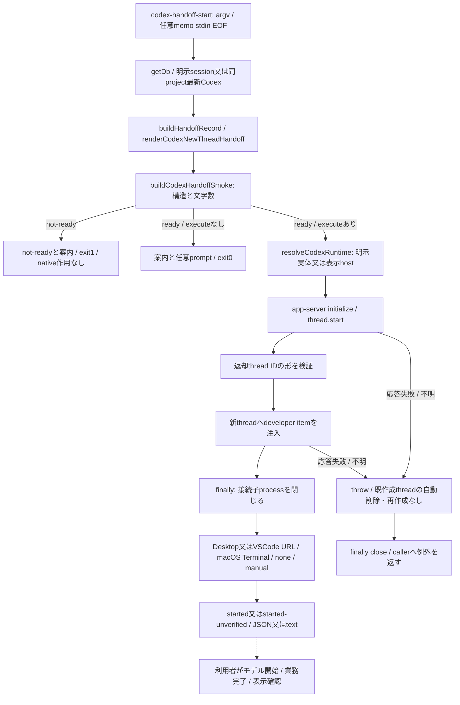
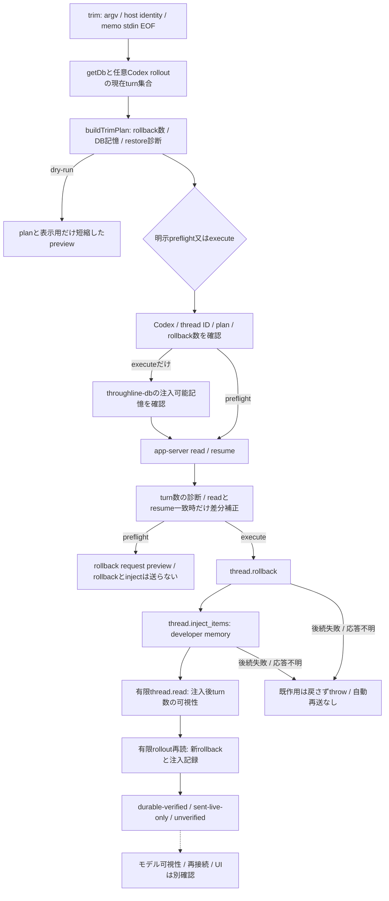
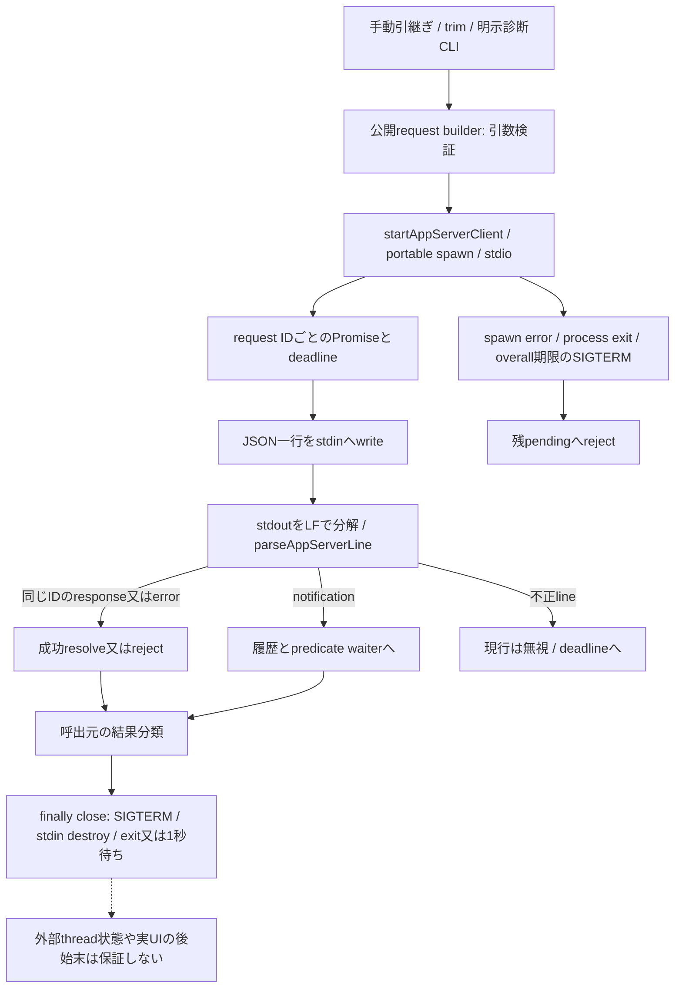

# 手動継続・trim・app-server診断の現行source対応

基準 `39ff812d46c0e84e8fc1418096c509551cf3928b`。[全体索引](README.md)→本詳細→実file/関数へ辿る。source読取段階の現行図で、整理案の採否・コード変更・新batch追加は含めない。新3図は実描画/目視済みで[描画manifest](render-manifest.json)へ対応付けた。Astra最終整合は未了。実app-server・rollout・Hostを操作して確かめた図ではない。

## 手動の新スレッド引継ぎ

図の`thread.start`は実protocolの`thread/start`を表す。手動CLIは`delivery=developer-item`で呼び、`turn/start`を送らない。`started`でも`turnStatus=not-started`であり、モデルによる引継ぎ記憶の利用・業務完了を証明しない。`none`は表示を要求しない成功、非macOSのCLIは手動案内、URL handlerの終了0も画面反映の証明とは別である。

| 実file/関数 | 入力・所有・返却と副作用 | 保持/未確認 |
| --- | --- | --- |
| [cli/codex-handoff-start](../../src/cli/codex-handoff-start.mjs):parseArgs/findLatestCodexSessionId/buildGuidance/run | getDb経由で製品DBの初期化/移行作用あり。明示session又は同projectのCodexだけ選択し、memoと既rendererを検査。execute時だけnative作用へ進む | default/引数制限/exit/JSON/案内を保持。同名session指定の意味とauto経路のsource束縛を混同しない。read-onlyな公開handoff-contextとは接続が異なる |
| 同:resolveOpenHost/isCodexDesktopEnvironment/openStartedCodexThread | autoはDesktop識別をVSCode信号より優先。OS共通URL/Terminal helperへ委譲、requested/resolvedを両方返す | Hostは外部所有。表示失敗で既作成threadや注入を取り消さない。元threadは変更しないが新threadを作る作用はある |
| [codex-handoff-smoke](../../src/codex-handoff-smoke.mjs):buildCodexHandoffSmoke/findDetailSuffixes | 純粋な構造検査。既定12000字、header/source/reading contract/開始案内/L2等。記憶やconsumer状態は保存しない | 詳細suffixの出現数と全L3の網羅を同一視しない。モデル可視性の検査ではない。短縮手動rendererの制限をauto全文記憶へ適用しない |
| [cli/codex-handoff-smoke](../../src/cli/codex-handoff-smoke.mjs):parseArgs/findLatestCodexSessionId/run | DB→record→構造検査をtext/JSON、readyだけexit0 | getDb初期化作用とprompt検査自体のread-only性を区別。引数parser/session選択/stdin処理の類似は観測のみで統合採否は未定 |
| [codex-handoff-model-smoke](../../src/codex-handoff-model-smoke.mjs):buildCodexHandoffModelSmokePrompt/runCodexHandoffModelSmoke | promptへmarker指示を付け、明示callerからephemeral/read-only Codex execを同期起動。timeout/spawn/nonzeroとstdout marker有無を返す | helper自体にopt-in gateはなくCLIが持つ。source本文読取だけで実モデル試験済みにしない |
| [cli/codex-handoff-model-smoke](../../src/cli/codex-handoff-model-smoke.mjs):parseArgs/run | 非dry-runは実験env確認をDBより前に行う。構造ready後だけモデル起動。dry-runは結合prompt/command/proofScopeのみ返す | env guard・memo再現・上限と失敗分類を保持。dry-runでもgetDbが先にある。新thread引継ぎの受付と別の検証経路 |

手動native経路の進行は呼出processのlocal変数と外部Codexのthread状態にあり、[自動継続](current-continuation.md)のmutation-stage/CAS/再開台帳は使っていない。作成後の通信失敗や出力消失を「未作成」「再実行可」へ補完しない。ここに共通台帳を追加する設計判断はまだしていない。

## 同一threadのtrim

`thread.rollback`/`thread.inject_items`は実protocolのslash名を短縮表記した。preflightでも`thread/resume`と接続process起動は行うため、無作用とは呼ばない。trimは`turn/start`を送らず、Throughline記憶を削除する処理でもない。DB記憶と外部rolloutは所有が異なり、rollout previewがあってもDB記憶無しのexecuteは注入前に拒否する。

| 実file/関数 | 責任・状態所有・返却 | 失敗/取消/保持 |
| --- | --- | --- |
| [trim-model](../../src/trim-model.mjs):buildTrimPlan/resolveDefaultSessionId/countDistinctCapturedTurns/collectMemoryPreview | 製品DB又は明示rolloutのturn数から計画。Codex既定sessionはそのthreadに固定し、同projectの最新Claudeへfallbackしない。元記憶はDB優先 | 同期計画に公開取消なし。query失敗のnull/0互換を保持。Claude rewindはmanual-only、unknown hostは自動化不可 |
| 同:estimateContextReduction/buildPlannedRollbackRestoreSafety/renderTrimDryRunReport | chars/4の推定削減とcompacted保持の診断。text previewだけ切詰め、JSONのmemoryPreview全文は保持 | restore riskやschema primitive候補は現行execute gateではない。既解除gateを復活させない。推定を実tokenizer計測へ補完しない |
| [cli/trim](../../src/cli/trim.mjs):run/validateCodexAction/hasInjectableMemory/runPreflight/runExecute | parse→identity→DB/rollout計画→明示mode。executeだけDB記憶条件を追加。引数エラー/拒否/失敗は既exitを保持 | dry-run指定時の他mode扱い、thread identity・memory session別指定の互換性を保持。全関連testはまだ未読 |
| 同:classifyCodexExecutionResult/waitForDurableRolloutEvidence | 30回/100ms間隔の上限でrolloutを再読。turn-count matchに加え新rollbackと注入記録の増加を確認してdurable-verified | 無pathはlive-only、読取失敗/記録未確認はunverified。外部作用済みで失敗しても元へ戻らない。count/記録の証拠を今回の実測としない |
| [codex-auto-refresh](../../src/codex-auto-refresh.mjs):runCodexAutoRefresh/evaluateCodexAutoRefreshUsage | 互換exportのdisabled既定。明示enabled時だけverified usage/rollout/DB記憶からtrimへ。現hookはcurrent-thread refreshを呼ばない | 既定無効/旧停止を保持。ここを自動継続の代替や新しいtimerとして接続しない |
| 同:buildCodexAutoRefreshFingerprint/checkCodexAutoRefreshBackoff/recordCodexAutoRefreshOutcome/createFileCodexAutoRefreshStateStore | private fileに実行前startedと最大50件のfingerprint、作用後は次user turnまでquiet。rollout世代/usage5%刻みを使う | file writerは単純JSON書込で、atomic/CAS/排他の保証はここに無い。実行throw後もstarted印は先行し得る。既無効経路の構造採否はAstraで検討 |

## app-server通信と診断の証明範囲

| 実file/関数 | 現行の責任と根拠 | 保持/未確認 |
| --- | --- | --- |
| [codex-app-server](../../src/codex-app-server.mjs):encodeAppServerMessage/parseAppServerLine/buildInitializeRequest/buildThreadStartRequest/buildThreadReadRequest/buildThreadResumeRequest/buildThreadTurnsListRequest/buildThreadRollbackRequest/buildThreadInjectItemsRequest/buildTurnStartRequest | protocolの形と最低限の引数を検証するexport。実験API初期化、thread/turnとdeveloper/user itemを区別 | parseできるserver requestはtransport側で応答処理へ接続されていない。通知保存や未改行stdoutのhard上限を供給済みとしない |
| 同:startAppServerClient/initializeThroughlineAppServerClient/collectAgentText | requestとnotificationの相関、要求/全体期限、stderr返却時4000字へ短縮。finallyは子接続processの終了を要求 | AbortSignal/公開cancel APIなし。closeは1秒後返り得てSIGKILLや外部turn取消ではない。全timer/listener/親終了の回収を確認済みとせず、timeout/exitの関連fixtureを残す |
| 同:runCodexNewThreadHandoff/runCodexDeveloperMemoryInject/runCodexTrimPreflight/runCodexTrimExecution | 上2図のnative作用とfinally closeを所有。各順序の中間確定は外部Codex所有 | 自動継続の永続unknown台帳と同じ契約ではない。通信例外から外部の未作用は断定できない |
| 同:runCodexThreadRestoreSmoke/readCodexThreadWithFreshAppServer/listAllCodexThreadTurns/compareRestoreTurnCounts | fresh processを複数cycle起動しread/resume/turns-listを有限pageで検査。page上限時はcomplete=false | process再起動の証明範囲だけでrestartSafe=false。一覧打切りを完全読取にしない |
| 同:inspectAppServerRestoreTextMatches/findNeedleLocationsInValue/classifyResponseTextLocation/summarizeAppServerRestoreTextMatches | retained textの位置をdirect本文/replacement_historyと引用tool出力に分ける | 一致探索と位置最大20件は診断でありモデルの非可視性の証明ではない |
| 同:runCodexModelVisibilitySmoke/runCodexRollbackModelVisiblePrepare/runCodexRollbackModelVisibleVerify | opt-in CLIから注入/モデルターン又はcontrolled rollbackを行いmarkerを観測 | 呼出helper自体はgateを持たずCLIが持つ。準備の完了通知未観測とprepared、任意通知predicateとthread/turn相関の全testは照合事項。今回これらを実行しない |
| [cli/codex-restore-smoke](../../src/cli/codex-restore-smoke.mjs):run/buildRestoreTextNeedles | env/ID/rollout/restore riskのguard後だけfresh process検査。明示inspect-riskyでもexit1 | count安定、quoted retained text、blocking candidateを区別。外部環境の現在の安全性を今回再確認していない |
| [cli/codex-visibility-smoke](../../src/cli/codex-visibility-smoke.mjs):parseArgs/run | env後にDB記憶を作りnative inject/turnを起動、markerのagent deltaを返す | このCLIの同project最新検索はSQL lower比較。他のsameProjectPath検索との差を未検討のまま統一しない |
| [vscode restore](../../src/codex-vscode-restore-smoke.mjs):inspectCodexVsCodeRestoreSmokeRollout/inspectRolloutRows と [CLI](../../src/cli/codex-vscode-restore-smoke.mjs):prepareSmoke/verifySmoke | prepareはenv必須の注入。verifyはproject束縛rolloutを読みmarker-free prompt/marker-only answer/利用者本文leak無しと再起動申告を照合 | restartは利用者申告で製品が操作しない。marker言及だけでは合格にしない。注入記憶保持とrollback非復活は別の証明 |
| [vscode rollback](../../src/codex-vscode-rollback-smoke.mjs):inspectCodexVsCodeRollbackSmoke と [CLI](../../src/cli/codex-vscode-rollback-smoke.mjs):run | rollback event/除外user本文/後続user/restore ok/再起動申告を読むだけ | 実reloadやUIは操作しない。risk/pending/未申告を成功へ補完しない |
| [cli/codex-rollback-model-visible-smoke](../../src/cli/codex-rollback-model-visible-smoke.mjs):runPrepare/runVerify/readMarkerFile/writeMarkerFile/maybeRedactMarker | env/identity後、mode別の実モデル/rollback。明示marker fileは作用前に0600で保存、tool結果からmarkerを伏せる | marker/prefixとnot-visibleの区別、採取汚染を防ぐ。fileは診断原本として残り自動削除しない。停止中の旧調査をこの読取で再開しない |
| [host primitive audit](../../src/codex-host-primitive-audit.mjs):runCodexHostPrimitiveAudit/classifyCodexHostPrimitiveSchema/extractJsonRpcMethods/buildHostAgnosticRepairContract と [CLI](../../src/cli/codex-host-primitive-audit.mjs):run | 既schema dirを読む又はCodexからschema生成→method候補を分類。生成tempは既定finally削除、keep指定時保持 | schema-only、候補があってもrestartSafePrimitive=false。schema生成はCLIを起動するため今回未実行。同期spawn取消/期限の保証を追加しない |
| [restore source audit](../../src/codex-restore-source-audit.mjs):runCodexRestoreSourceAudit/inspectSessionIndex/inspectCodexStateDatabase/inspectStorageRoots/inspectSqliteStorageFile/inspectVsCodeExtensionRoots/inspectVsCodeSettingsRoots/inspectVsCodeLogRoots/summarizeAudit と [CLI](../../src/cli/codex-restore-source-audit.mjs):run | 既存の明示診断入口。Codex/VSCode所有のrollout/index/DB/storage/settings/log/sourceをread-onlyで棚卸し、件数/byte/一致数を制限しtruncatedを返す。DBはfinally close | private storeの監査readerであり通常consumer用の公開変更世代APIではない。実体を開かずsourceだけを読んだ。pattern近傍からの仮説を外部実装の確定やrestart-safeへ補完しない。Host修理の所有を引き取らない |

## caller・試験・設定/exportの残り

binの各dispatch、doctor/trim/refresh/手動CLI/diagnostic CLIからapp-server・trim-modelへの参照を検索し、今回上表のsource全20fileを本文確認した。`codex-auto-refresh`はproduct source内で通常hookからの呼出が無いことを参照検索し、既読hookの無効結果と照合した。doctor/導入本体は[製品寿命/運用入口](current-lifecycle.md)へ接続する。skill・設定と全caller閉包は未完。

今回本文確認したtestは`codex-app-server.test.mjs`、`cli/codex-handoff-start.test.mjs`、`trim-model.test.mjs`の3file。fake process/一時DB/rollout fixtureを内包するが未実行。`trim-cli.test.mjs`、refresh・smoke/auditの全test、package export/skill/hooks/installと外部consumerは未了。入力境界・例外・保持・既定無効を変えずに責務を整理する採否は、全体調査後のAstra工程で行う。

[docs/05](../05_codex_first_roadmap.md)の本文を読み、現行自動新thread継続・手動新thread・明示同thread trim・無効refresh・過去実測を区別した。既存図には後追いADRの停止前準備を注記で補うものがあり、現行詳細図の実順を旧phaseのチェックリストへ合わせない。本文の読了は過去の実測を今回再実施した意味ではない。
