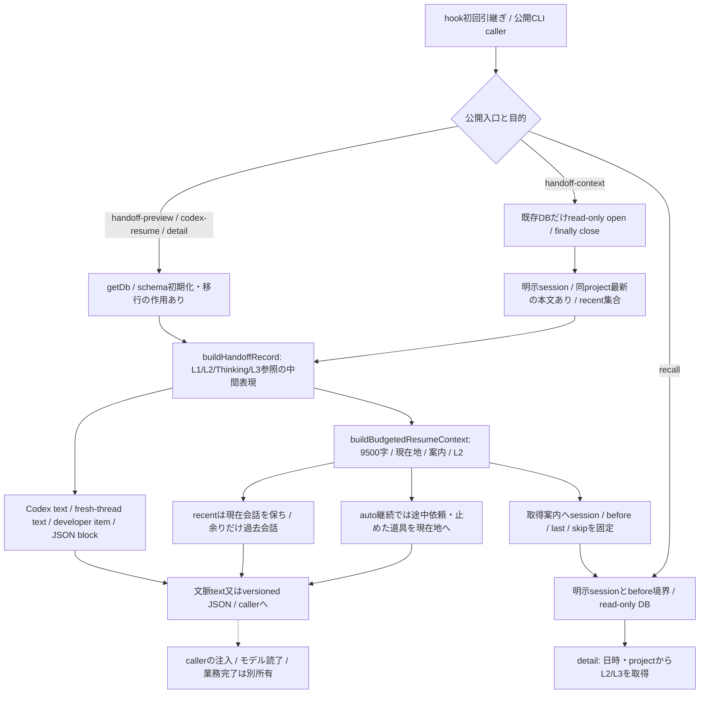
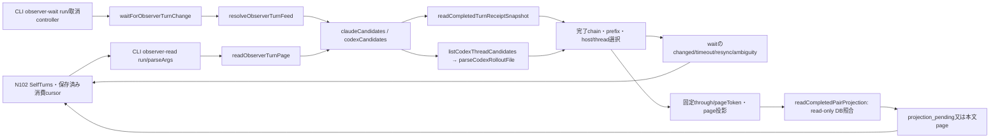
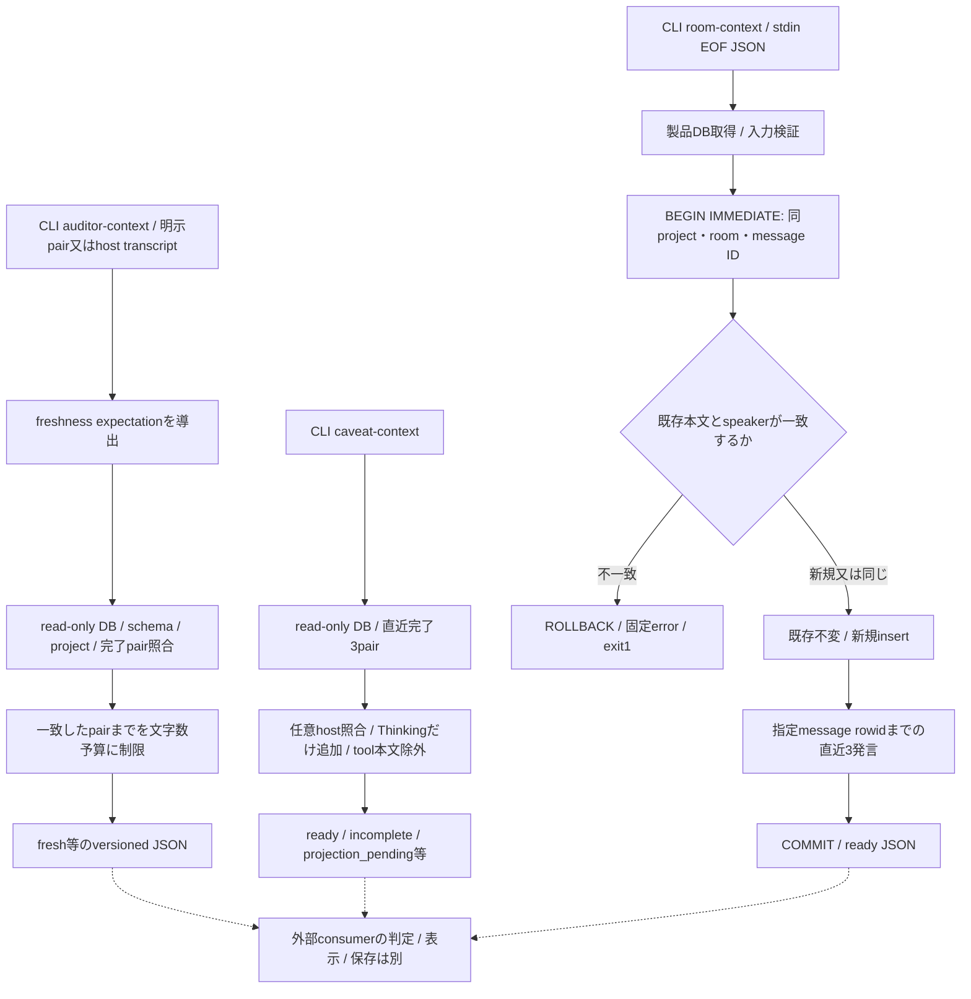

# 文脈復元・observer・外部文脈の現行source対応

基準 `39ff812d46c0e84e8fc1418096c509551cf3928b`。[全体索引](README.md)→本詳細→file/関数へ辿る。Solのsource読取段階であり、整理案の採否/実装/Astra最終整合は未着手。実DB・実harnessで確認した図ではない。新しい復元/room図は未描画、observer図は既描画原稿を再利用する。

## 記憶の読取と表現の境界

図の`getDb`はpure projectionそのものの書込ではなくCLIの接続初期化の作用。公開`handoff-context`と`recall`はread-onlyを使うが、`handoff-preview`/`codex-resume`/`detail`まで同じread-only接続と補完しない。hook側のmerge/pending/acceptedは[記録図](current-entrypoints.md)と[自動継続図](current-continuation.md)に正本を置く。

| source / 関数 | 入力・返却と状態所有 | 保持契約/未確認 |
| --- | --- | --- |
| [handoff-record](../../src/handoff-record.mjs):buildHandoffRecord/formatTime/loadBodies/loadL1Summaries/loadLatestThinking/loadL3References | DBを読み、中間record v1を返す。直近20turnはorigin+turnで選び、古いL1と最新Thinking、L3取得参照を分離。record自体は保存しない | 既存のquery失敗→null/空arrayという互換動作を保持。source adapter推定は現状Codex/Claude区別であり、4harness正本への変更採否は未定 |
| [resume-context](../../src/resume-context.mjs):buildResumeContext/buildBudgetedResumeContext/buildResumeSections/renderBudgetedSections/groupL2Turns/buildGuidanceLines | 無制限rendererと予算付きrendererは別export。予算付きは9500字、現在地/案内を予約しL2を新しい順にturn原子で選んで古い順に表示。最新だけ明示切詰め可 | L1/Thinkingを通常pushへ注入しない。旧memo引数は互換の無作用。pull境界はISO ms strict less-thanとして固定し、recall側で窓を再計算しない |
| 同:buildRecentSessionsContext/loadSessionTurnSpans/renderPastBlock/renderPastIndexLine | 現在会話の本文は不変、残予算だけ同project過去会話へ。origin+turnを重複排除、途中で入らないturnより古い本文へ飛ばない | 複数sessionをDBで合流しない。過去会話の依頼を現在の依頼として再開しない説明を保持。索引/recall件数の既上限を維持 |
| 同:buildAutoContinuationContext/renderInFlightSteps/truncateInFlight | 途中依頼・実行済み/未実行道具・最終発言・backgroundを現在地へ。捕捉済み途中turnはL2一覧から外す | 途中turnを古い記憶へ二重計上しない。文脈生成はaccepted後なので、その失敗で受領済みを取り消す保証は無い |
| [cli/handoff-context](../../src/cli/handoff-context.mjs):parseArgs/readHandoffContext/readLatestProjectHandoffContext/readRecentProjectHandoffContext/readSessionProjectPath/renderHandoffSupplement/run | session/project/recentを選択、projectに束縛したsupplementを予算に含める。read-only、DB不存在は新規作成しない、finally close。v1 ready/empty JSON | project emptyはexit0、session unavailableはexit1、構文はexit2。supplement/disclosure/recentの組合せ拒否を保持。本文の所有/消費位置を変更しない |
| [latest-session](../../src/cli/latest-session.mjs):findLatestSession/parseArgs/run | 同projectの更新時刻最新IDをread-onlyで返す | 本文を持つ会話を選ぶhandoff-contextとは異なる意味。候補なしempty、読取失敗exit1を混同しない |
| [handoff-preview](../../src/cli/handoff-preview.mjs):run / [codex-resume](../../src/cli/codex-resume.mjs):run | getDb→record→既存Codex renderer。Codexはmemo stdin/3formatと制限引数を持つ | JSON/textを生成しただけで配送しない。format/旧引数/export/既default session選択を勝手にそろえない。manual起動/trimの下流は未読 |
| [recall](../../src/cli/recall.mjs):parseRecallArgs/runRecall/renderRecallL1/renderRecallL2/run | 明示session/before、L2 last、L1 skip/lastでread-only取得。L1未要約を明記、L3は参照suffix | DB未存在/引数/接続/queryは明示失敗、finally close。注入時の境界から追記後も同じ担当範囲を読む |
| [sc-detail](../../src/sc-detail.mjs):parseDetailArg/detailRangeOn/run | 明示日時又は最近該当日の同project本文→対応turnのL3をbatch読取。getDb経由、範囲とkind別text表示 | 同時刻の複数turnを保持。project比較/日時/Thinking表示の全caller・README・fixture照合は未了。既sourceにThinking専用表示枝が無い点は照合事項として残す |

同期rendererとread-only queryに公開AbortSignalは無い。文脈生成失敗はcallerへ戻り、出力後の取消・reader消失で新しい消費位置を製品が保存する経路も無い。DB handleはread-only wrapperのfinallyでcloseするが、強制終了で全cleanup実行を保証しない。`handoff-record`の空/部分fallbackと外側の明示失敗の差は構造整理で保存すべき既存挙動として調べる。

## Observer: 既描画の現行図を再利用

[既描画SVG](diagrams/observer-current.svg)。Mermaid原稿は固定草案4344c16の第2block（末尾LF込みSHA256 `c18c482eb1d4bb05c2b7d6997803f20ac5407c78e2e3d29667d979c3723f5e7b`）と同bytes。SVGも既受入の `b4457cc284a61f103e370c28c9dc12fed5b2e6b0f3aa322344292e62b7663029` を再利用し、同じ描画/目視を反復しない。以前の図の限界であるreceiptと本文freshness、長い横図の拡大読取条件を保持する。現在sourceとの本文対応を以下へ追記し、有限の描画受入を製品全体の整合受入には広げない。元の草案/描画レビューは当席docsの監査原本として固定したまま保持する。

| source / 関数 | 正常返却と状態の所有 | 失敗・取消・部分成功・保持 |
| --- | --- | --- |
| [feed](../../src/observer-turn-feed.mjs):resolveObserverTurnFeed/claudeCandidates/codexCandidates/codexTurnEntry/selectLatest | Claude互換receipt又はCodex task_completeから完了chainを作り、最新host/threadを選ぶ。本文DBやmtimeを完了証拠にしない | 同時刻cross-hostはambiguous。旧source消失/rollback/prefix不一致はswitchへ補完せずresync。各pollで候補探索/rollout parseを行う既構造で、batch/O(1)供給済みではない |
| 同:encodeObserverCursor/decodeObserverCursor/validateCursorCandidate/prefixDigest | project SHA/host lane/thread SHA/length/prefixをopaque cursorへ。形はv1を保持 | history_floorは形に残すが位置検証では比較しない（ADR0035）。prefixが一致する既cursorを不必要に失効させない。cursorは認可鍵やconsumer保存値ではない |
| 同:readObserverTurnPage/logicalDeltaSeries/fixedCandidate/projectReadPage | snapshotは直近limit件・historyTruncated付きでcomplete。deltaは固定throughまでpage分割。limit1..100、既定10 | page tokenはproject/after/through/offset-prefixに束縛。本文pairが一つでも不足なら全pageのturns空、through=null、complete=false/next=null。前の成功pageを製品が保存確定するわけではない |
| 同:decodeObserverPageToken/validatePageTokenBinding/validatePageTokenPrefix/harnessOf | cursorは共通、page tokenはcanonical符号化を検証。v1は既lane/本文制限、v2は全文/実harness/turn_start | Grok/Cursorは互換receipt laneを使う。v2だけ実session prefixからhostを求め、v1はclaude laneのまま。wire切替でcursorを変えない |
| [auditor](../../src/auditor-context.mjs):readCompletedPairProjection/buildCompletedPairs/matchExpectedPairs/fullProjectedPairs | read-only DB v9..current、project同一又は子孫、origin/user/assistant hashの順序付き全pair照合。v2 fullBodiesと旧turn_startのunknown | DB/session/pair不足はpending、schema/project/I/Oはhard error。busy待ちは1秒、finally close。完了証拠と本文freshnessを二重に混ぜない |
| [wait](../../src/observer-turn-wait.mjs):waitForObserverTurnChange/terminalWire/abortableSleep | timeout1..3600秒（0不可）、monotonic deadline、各wakeで完了cursorを再確認し、最後までunchangedだけtimeout | AbortSignalを開始前/解決後/sleep後に照合。timer/listenerを除去。waitは本文DBを待たず、changed後readでpendingを裁定。同期source走査中の即時中断やSIGKILL cleanupは保証しない |
| [cli/read](../../src/cli/observer-read.mjs):parseArgs/run/mapError / [cli/wait](../../src/cli/observer-wait.mjs):parseArgs/run/installCancellation | 必須JSON/引数/重複/limit/timeout検証、成功stdout1 JSON。waitはSIGINT/SIGTERM/disconnect/親ppid変化/ESRCHを単一controllerへ写す | 既知resync等はexit0、hard error/cancelはstderr固定JSON・exit1。EPERMを親不在にしない。finallyで親watchとlisteners除去、raw例外/path/本文を転記しない |

N102が消費cursor・pageの消費/保存・pendingの次巡再読を持つ。製品は確認値だけでconsumer保存を進めない。今回の候補へ新batch APIや変更確認tokenを足していない。元のbatch提案図と仮契約は実装済み機能の図へ混ぜない。

## Auditor / Caveat / Room

| source / 関数 | 返却と所有 | 保持/未確認 |
| --- | --- | --- |
| [auditor](../../src/auditor-context.mjs):deriveAuditorFreshnessExpectation/readAuditorContext/boundCompletedPairs/isSameProjectOrDescendant | host transcript又は明示pairとDBの両方を照合、boundedな完了文脈を返す。Codexはrollback後ordinalではなくorigin+両hashで照合可 | expectation不足/本文違いはstale。schema/session/projectの状態と例外を分け、finally close。通常auditorとobserver projectionでは返却/切詰め順が違う |
| [cli/auditor](../../src/cli/auditor-context.mjs):parseArgs/run/hasFreshnessSource | host+transcriptと明示pairは排他的入力、JSON-only | 曖昧な入力を補完しない。query/parseのraw例外を固定errorへ変換。全consumer未読 |
| [caveat](../../src/caveat-context.mjs):readCaveatContext / [cli/caveat](../../src/cli/caveat-context.mjs):parseArgs/run | 完了3pairが揃った時だけ本文と取得可能なThinking、各上限付き。任意host期待値不一致はpending。tool本文を含めない | 3pair未満はincomplete、別projectを漏らさない。read-only/1秒busy/finally close。Thinking無しを存在すると補完しない |
| [room](../../src/room-context.mjs):recordRoomTurn / [cli/room](../../src/cli/room-context.mjs):run | project/room/message keyでDB保存、同じmessageの再送は不変。指定messageまで3発言を返す | read-only projectionと異なるwriter。既定db=getDb評価の接続作用は関数内の入力検証より先。内容相違はconflict/rollback。COMMIT後の出力失敗は保存取消ではない |

今回読んだ8testはlatest-session、room、caveat、observer core/wire/wait/Codex hash projectionで、実行はしていない。resume-context/handoff-context/auditor/recall/detailの大きなtest、Host以外の実consumer、fixture/config/export閉包は未完。`docs/02_clear_auto_handoff_plan.md`の二相step4はbackfill→mergeという説明だが、実executorはmerge→accepted→backfillであり、図は実source順を採用した。既正本文書の訂正は整理工程の差分で行う照合事項として残す。
