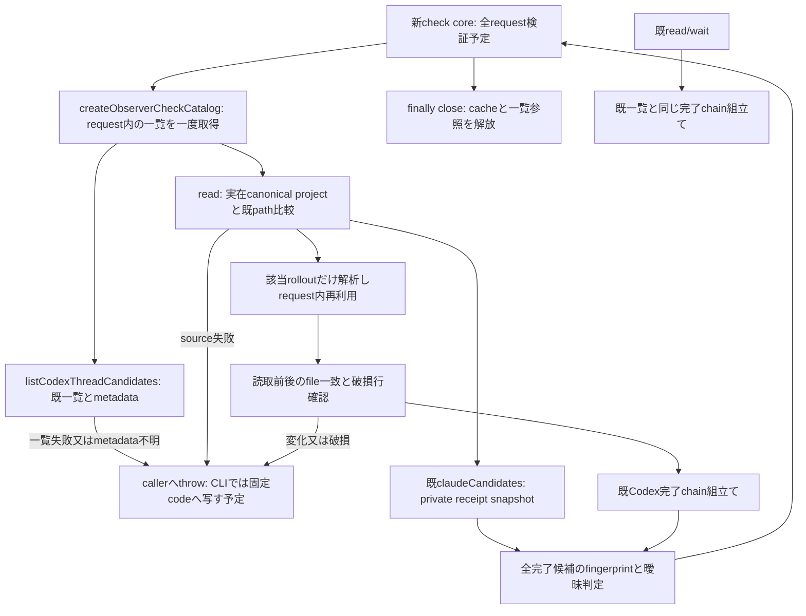

# observer-check: request内の完了source共有

状態: 段階1の内部catalogを実装する差分。CLI/request/result serializerは未供給。既全体索引のobserver責任を拡張し、既read/wait/cursor/本文投影は保持する。固定草案4344c16と出力追補が契約入力で、consumer順序/保存はN102、runnerはruntime所有。

`observer-turn-feed:createObserverCheckCatalog`がrequest内の一覧/parse cacheを所有し、`read(projectPath)`はproject SHA、全候補fingerprint、曖昧判定だけを返す。本文DB/consumer cursor/永続stateへの作用は無い。呼出元の新coreがfinallyでcloseする。同期source読取中の即時取消は保証せず、core/CLIでsourceと項目の境界にyieldと取消確認を設ける（次段階）。

Codex project比較はindexの既normalize/descendant判定を参照し、case/realpathの別実装を作らない。新catalogは候補の一覧/metadataを1回取得し、同じrolloutの全文解析を高々1回にする。先頭metadataと全文parseは別計数。読取中の変更又は破損行は新checkで失敗にし、既read/waitの許容規則は変えない。metadataからprojectを特定できない一覧は全体失敗とし、未変更を作らない。

既indexの2pure helperを追加exportする以外、list/find/indexの既signature/返却は不変。feedの既Codex変換を共有関数へ抽出するが、既read/wait経路では同じparser/chain/filterを使う。保持試験はindex、feed、Codex projection、read/wait core/CLI。CLI dispatch/help/梱包/公開schemaは次差分で追加する。factory/monitor/doctor/codex-threads/capture/auto等の既index callerには引数変更が届かない。

取消・入力上限・一回stdout確定・固定code・token失効は新core/CLIの責任であり、この内部catalogだけで実装済みとしない。全体/詳細の既19図は不変、新図だけ描画する。

段階1の確認: 新catalog4件と既index/feed/projection/read/wait core/CLIを含む40試験が通過した。親子projectを跨ぐ一覧/先頭metadata/全文parseの回数、破損・発見後変化・空source束縛・close後拒否を人工fixtureで確認。133件性能/公開CLI/serializer/runner/3OSは未実施。新図の[SVG](diagrams/observer-check-01.svg)を描画し、PNG目視とXML/hash対応を確認した。既19図は再描画していない。
