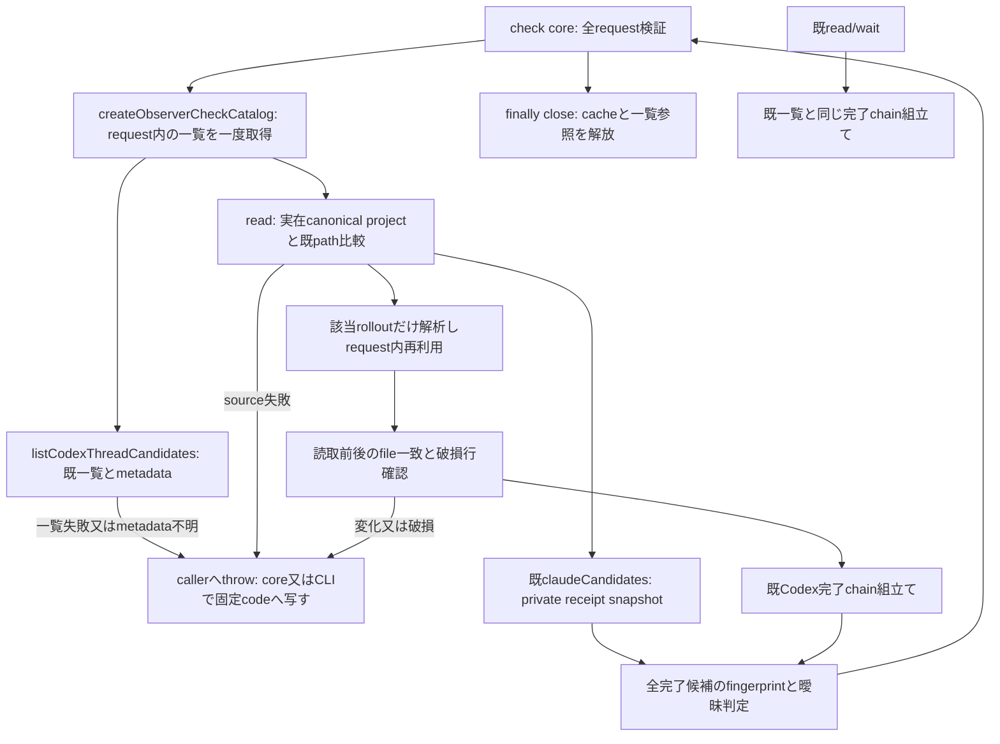
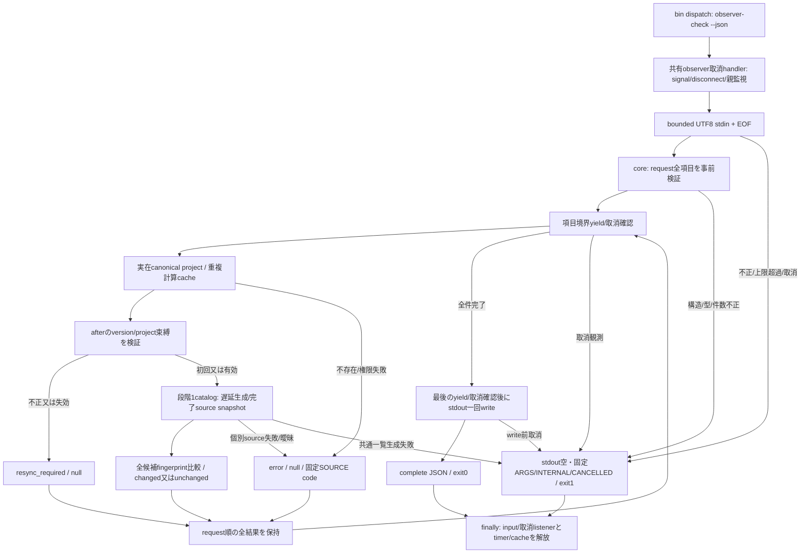

# observer-check: request内の完了source共有

状態: catalogと段階2のcore/CLIを実装した候補差分。候補schemaは [observer-check.schema.json](../observer-check.schema.json)。正式公開版/性能/runner供給受入は未成立。既全体索引のobserver責任を拡張し、既read/wait/cursor/本文投影は保持する。固定草案4344c16と出力追補が契約入力で、consumer順序/保存はN102、runnerはruntime所有。

`observer-turn-feed:createObserverCheckCatalog`がrequest内の一覧/parse cacheを所有し、`read(projectPath)`はproject SHA、全候補fingerprint、曖昧判定だけを返す。本文DB/consumer cursor/永続stateへの作用は無い。呼出元の新coreがfinallyでcloseする。同期source読取中の即時取消は保証せず、core/CLIでsourceと項目の境界にyieldと取消確認を設ける（段階2）。

Codex project比較はindexの既normalize/descendant判定を参照し、case/realpathの別実装を作らない。新catalogは候補の一覧/metadataを1回取得し、同じrolloutの全文解析を高々1回にする。先頭metadataと全文parseは別計数。読取中の変更又は破損行は新checkで失敗にし、既read/waitの許容規則は変えない。metadataからprojectを特定できない一覧は全体失敗とし、未変更を作らない。

既indexの2pure helperを追加exportする以外、list/find/indexの既signature/返却は不変。feedの既Codex変換を共有関数へ抽出するが、既read/wait経路では同じparser/chain/filterを使う。保持試験はindex、feed、Codex projection、read/wait core/CLI。CLI dispatch/help/梱包/候補schemaは段階2で追加した。factory/monitor/doctor/codex-threads/capture/auto等の既index callerには引数変更が届かない。

取消・入力上限・一回stdout確定・固定code・token失効は新core/CLIの責任であり、この内部catalogだけで実装済みとしない。全体/詳細の既19図は不変、新図だけ描画する。

段階1の確認: 新catalog4件と既index/feed/projection/read/wait core/CLIを含む40試験が通過した。親子projectを跨ぐ一覧/先頭metadata/全文parseの回数、破損・発見後変化・空source束縛・close後拒否を人工fixtureで確認。133件性能/公開CLI/serializer/runner/3OSは未実施。新図の[SVG](diagrams/observer-check-01.svg)を描画し、PNG目視とXML/hash対応を確認した。既19図は再描画していない。

## 段階2: CLI・確認値・取消の所有

この差分で `observer-check --json` を接続した。正規request/result/errorのshapeは固定草案4344c16と同じ。入力は1MiBのUTF-8 JSON+EOF、全field/件数/bytes/重複idを先に検証。存在/権限のproject失敗は個別SOURCE。確認値は`tloc1.`のcanonical base64url、内部version/projectSHA/全完了候補fingerprintへ束縛する。確認値は512 ASCII bytes以内で、旧/不正/別project値はresync。cursorは変更しない。

coreは`checkObserverProjects`、CLIは`src/cli/observer-check.mjs`。既waitの取消handlerを下位`observer-cancellation.mjs`へ同一処理で移し、waitの`_internal.installCancellation`と親監視間隔を互換参照で保持する。共通化のcallerは既wait・その試験と新checkだけである。

正常stdoutは全件完了の一JSON+LF、stderr空。全体失敗はstdout空/固定schema/status/code+LFでexit1、個別SOURCEでも全項目を返せればcomplete/exit0。本文/path/stack/raw errorを公開結果へ含めない。write前までに観測した取消では全結果を破棄する。write開始後のpipe断/強制終了/consumer取消による不完全JSONは結果不明として不採用であり、転送済みbyteの撤回を保証しない。listenerはerror/closeとwrite callbackで回収する。閉じたstderrへは報告できないが失敗exitを返す。

readonly完了source、確認値生成、consumerの全page/append/state後採用は別の確定点。pending先行/同巡除外/N0起動0/分割と前request成功保持はN102が所有し、CLIは分割しない。同期read中の即時取消と強制終了finallyは保証外。有限133件性能/最大serializer/既runner/3OS・配布版は後続検証で、段階2実装を供給完了としない。

段階2の確認: 新core4件・CLI9件と既catalog/index/feed/projection/read/waitを含む53試験が通過。1MiB境界/超過・分割UTF-8/EOF・引数・不正token/project束縛・canonical重複・全体/個別失敗・stdin中/出力前取消・親変化・pipe切断・閉じた出力の失敗を確認。最大escaped id/512-byte token fixtureを実CLI serializerへ通し、stdout一回・順序/id一致・16MiB未満をassertした。これはserializerの直接検証で、133件source性能/実runner/3OSの成立とは別。
